<div align="center">

# Panel

**AI 模拟面试官 · 简历批注与复盘平台**

上传一份简历，拿到逐条批注、真正能改的编辑器、一场数字人模拟面试，以及一份说得出问题的复盘报告。


</div>

<p align="center">
  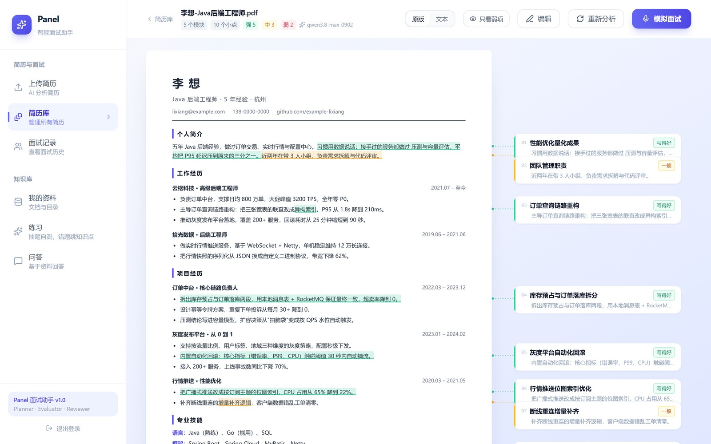
</p>

---

## 目录

- [它解决什么问题](#它解决什么问题)
- [功能一览](#功能一览)
- [界面截图](#界面截图)
- [技术栈](#技术栈)
- [架构](#架构)
- [快速开始](#快速开始)
- [目录结构](#目录结构)
- [几个关键设计](#几个关键设计)
- [测试与回归](#测试与回归)
- [关于示例数据](#关于示例数据)

---

## 它解决什么问题

求职者最缺的不是"简历模板"，而是**面试官视角的反馈**：哪一段写得太虚、哪个成果没有量化、真被追问时哪里答不上来。

Panel 把这三件事串成一条链路：

1. **看见问题** —— 简历被逐条批注，每条都引用原文，标注强 / 中 / 弱
2. **真的改掉** —— 不是给一堆建议让你自己找，而是直接提供三种编辑器，改完能导出
3. **被追问一遍** —— 对着改好的简历做一场模拟面试，被打分、被追问、被复盘

> 一条完整的链路：`上传 → 解析 → 逐条批注 → 编辑排版或重写内容 → 模拟面试 → 复盘报告`

## 功能一览

### 简历与批注

| 能力 | 说明 |
|---|---|
| 多格式解析 | PDF / DOCX / Markdown / TXT，按 Content-Type 分派到不同解析器 |
| 异步流水线 | `PENDING → PARSING → ANALYZING → PARSED`，前端轮询，失败可重试 |
| 逐条批注 | 按「模块 → 小点」组织，每点带等级（强/中/弱）、原文引用与字符级锚点 |
| PDF 原版高亮 | 页面渲染图 + 批注矩形定位；扫描件等无文本层的文件自动退回文本视图 |
| 只看弱项 | 一键过滤，先补最该补的那几条 |
| 重新分析 | 原文不变，单独重跑解析与批注 |

### 三种编辑方式

编辑不是二选一，而是**按文件形态自动选路**，也可以随时切换：

| 方式 | 适用 | 特点 |
|---|---|---|
| **PDF 原位编辑** | 有文本层的 PDF | 点一块改一块，字体取自原件内嵌字体，可调版式、导出改后的 PDF |
| **Markdown 内容稿** | 任意来源 | 自由书写，`#` 即章节；保存后解析以内容稿为准，**原版排版不受影响** |
| **结构化编辑器** | DOCX / TXT / 扫描件 | 没有版面时的兜底，按段落改文字 |

Markdown 内容稿与原件是**双源**关系：内容稿只影响「解析与批注看到的正文」，原件的版式、预览和 PDF 导出完全不动 —— 想改排版回原版视图，想改文字用 Markdown。

### 模拟面试

<p align="center">
  
  <br>
  <sub>问题从简历里长出来：简历写了 RocketMQ 和 Kafka，就追问「分别用在什么场景、为什么不能互换」</sub>
</p>

- **数字人面试官**：实时视频形象 + 语音播报，三种人设（严肃型技术面试官等）
- **语音作答**：按住空格说话，实时转写（WS 流式 ASR），也可以直接打字
- **多智能体编排**：
  - `Planner` 从批注点里挑考点，可参考岗位 JD
  - `Interviewer` 逐题提问
  - `技术评委 / 表达评委` 并行打分，各自带证据
  - `Reviewer` 只在分数与证据矛盾时介入复核
  - `Reporter` 汇总成报告
- **追问**：按人设阈值触发，追几层可配（0–3）
- **状态机**：`IN_PROGRESS → COMPLETED / ABANDONED`，中途退出可以主动结束

<table>
  <tr>
    <td width="50%"><br><sub><b>随时回看</b>：点「记录」拉开抽屉，每轮问答与作答原文都在</sub></td>
    <td width="50%"><br><sub><b>结束即复盘</b>：答完全部主问题后直接进报告，中途也能手动结束</sub></td>
  </tr>
</table>

### 复盘报告

<p align="center">
  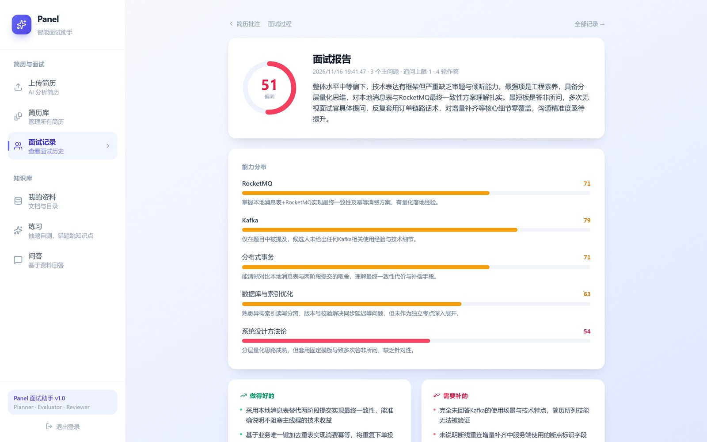
</p>

总分环、能力分布（每条能力有得分与一句话点评）、「做得好」与「需要补的」两类清单、逐题评分与证据。

### 知识库（同仓库的另一个模块）

文档入库 → 双库 RAG（Elasticsearch 关键词 + Milvus 向量）→ 题库、知识点与刷题。侧边栏里的「我的资料 / 练习 / 问答」即此模块，与面试模块共用同一套账号、租户与权限。

## 界面截图

<table>
  <tr>
    <td width="50%">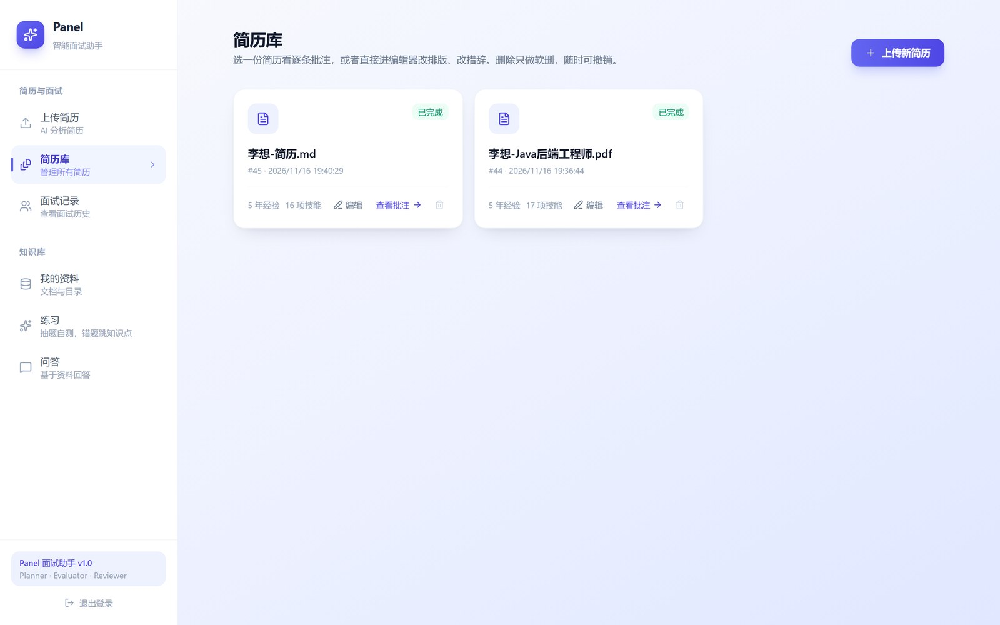<br><sub><b>简历库</b>：状态、经验年限、技能数一目了然，删除只做软删可撤销</sub></td>
    <td width="50%"><br><sub><b>上传</b>：拖拽即传，本机先做大小与格式预检</sub></td>
  </tr>
  <tr>
    <td width="50%">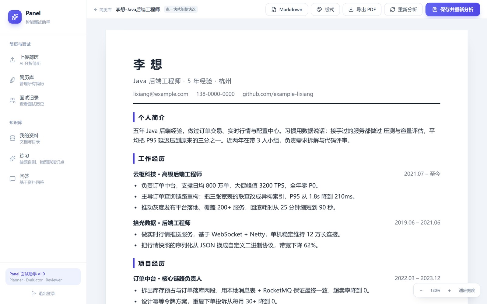<br><sub><b>PDF 原位编辑</b>：整块改字，字体与字号跟随原件</sub></td>
    <td width="50%">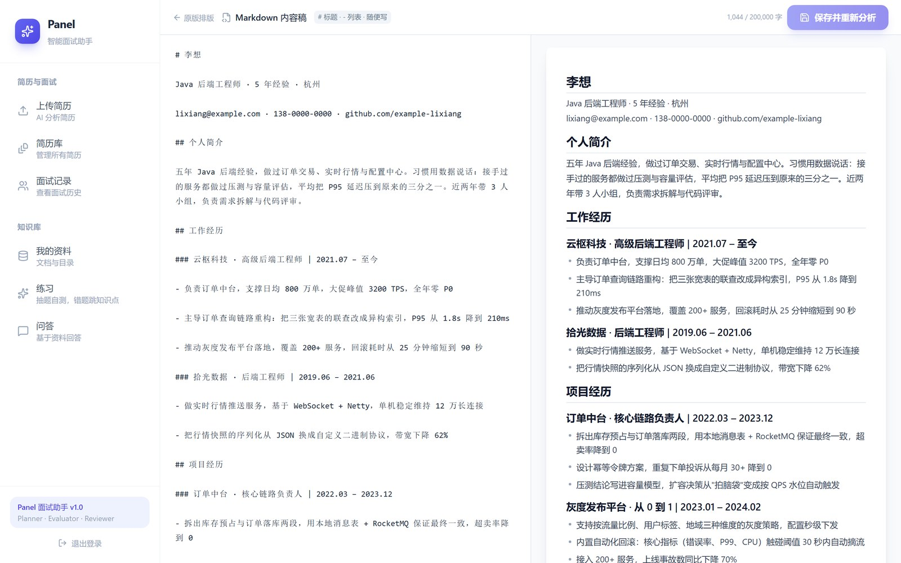<br><sub><b>Markdown 内容稿</b>：左写右看，`#` 即章节</sub></td>
  </tr>
  <tr>
    <td width="50%">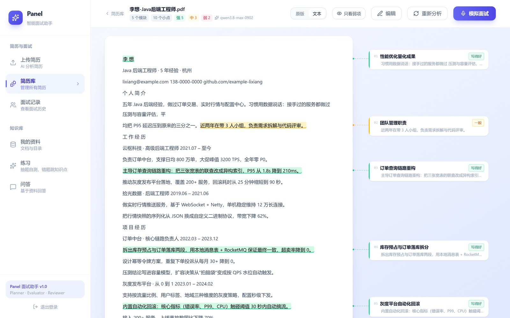<br><sub><b>文本视图</b>：没有版面也能对着原文看批注</sub></td>
    <td width="50%">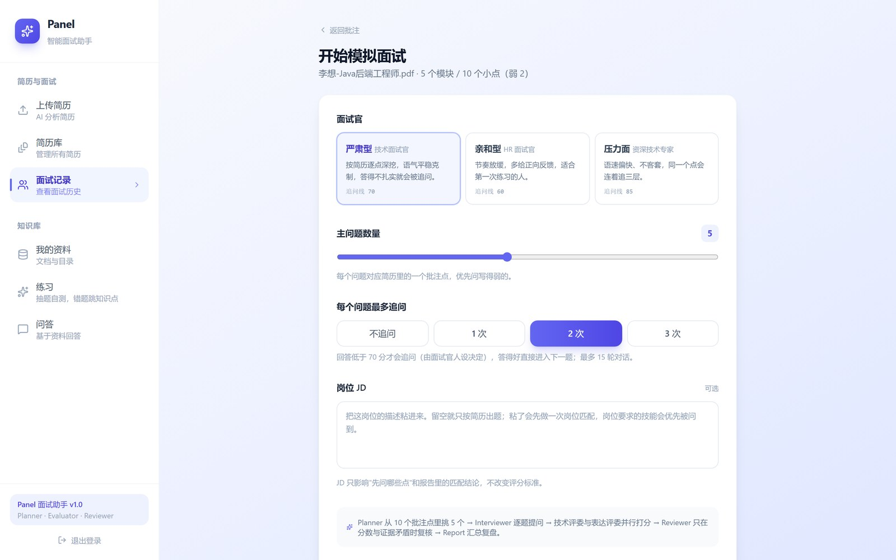<br><sub><b>面试设置</b>：题量、追问上限、人设、岗位 JD</sub></td>
  </tr>
  <tr>
    <td width="50%">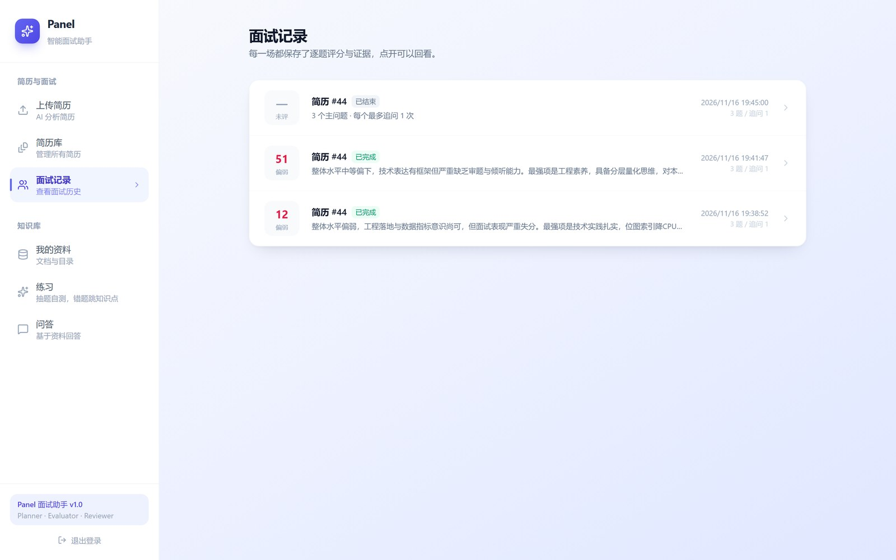<br><sub><b>面试记录</b>：历史场次与得分</sub></td>
    <td width="50%">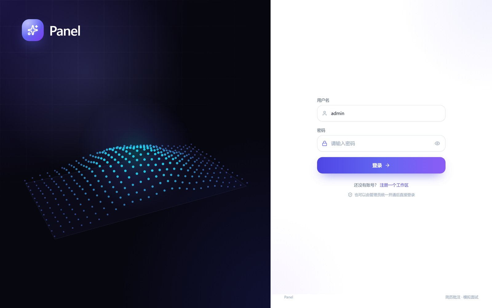<br><sub><b>登录</b>：租户隔离，账号由管理员开通或自助注册租户</sub></td>
  </tr>
</table>

## 技术栈

**后端**

| 组件 | 版本 / 说明 |
|---|---|
| Java | 21 |
| Spring Boot | 3.4.12（Web / Security / Data JPA / WebSocket / Actuator） |
| 数据库 | MySQL 8 + Flyway 迁移（`db/migration`，可重复执行） |
| 缓存 / 会话 | Redis |
| 对象存储 | MinIO（简历原件、页面渲染图、导出 PDF） |
| 消息 | Kafka（异步任务与重试队列） |
| 检索 | Elasticsearch（关键词）+ Milvus（向量） |
| 文档解析 | PDFBox 3.0.4、Apache POI 5.4.1 |
| 模型接入 | LangChain4j（DashScope 通义千问、Embedding、Rerank） |
| 认证 | JWT（jjwt）+ RBAC + 多租户 |

**前端**

| 组件 | 版本 / 说明 |
|---|---|
| React | 18 + TypeScript |
| 构建 | Vite 5 |
| 样式 | Tailwind CSS（自绘组件，未引入 UI 框架） |
| 路由 | React Router 6 |
| 图标 | lucide-react |

## 架构

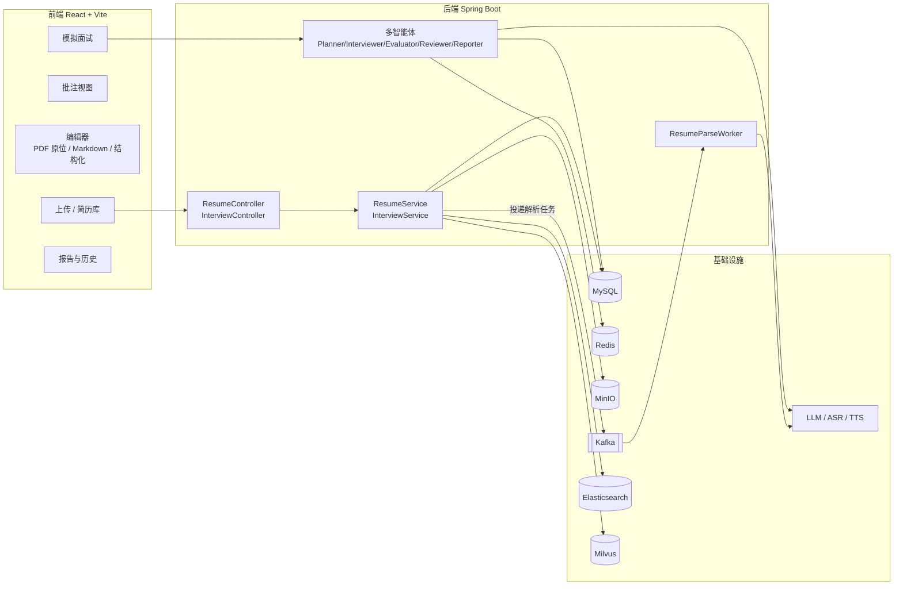

后端按领域分包，每个包内部再分 `api / application / domain / infrastructure`：

```
com.panel
├── interview      简历、批注、编辑层、模拟面试与报告      (77)
├── knowledge      文档入库、双库检索、题库与刷题          (203)
├── ai             模型网关、对话编排、工具调用、用量       (128)
├── iam            认证、用户、邀请、RBAC                  (67)
├── tenancy        租户、配额、设置                        (44)
├── shared         鉴权、异常、响应、任务队列、配置          (50)
├── agent          Agent 人设与提示词版本历史               (22)
├── audit          操作审计与 AI 用量查询                   (21)
├── ocr            OCR 识别                                (21)
└── platform       平台目录与启动引导                       (10)
```

## 快速开始

### 前置条件

- JDK 21、Maven 3.9+
- Node.js 18+
- Docker（起 MySQL / Kafka；Redis / Elasticsearch / MinIO / Milvus 可按需复用本机实例）

### 1. 准备配置

```bash
cp .env.example .env
```

至少填这几项：

```ini
MYSQL_HOST=localhost
MYSQL_DATABASE=panel_ai
MYSQL_USER=panel
MYSQL_PASSWORD=******

MINIO_ROOT_USER=minio
MINIO_ROOT_PASSWORD=******

DASHSCOPE_API_KEY=sk-******        # 模型调用必需：解析、批注、面试、语音
```

### 2. 拉起基础设施

```bash
# Windows
start-infrastructure.bat
# 或手动
docker compose up -d
```

### 3. 启动后端

```bash
# Windows
start-backend-dev.bat
# 或手动
cd backend && mvn spring-boot:run
```

默认监听 `8080`（可用 `SERVER_PORT` 覆盖）。首次启动 Flyway 会自动建表并执行全部迁移。

### 4. 启动前端

```bash
cd frontend
npm install
npm run dev          # http://localhost:5173，/api 已代理到 8080
```

### 5. 创建第一个账号

浏览器打开 <http://localhost:5173>，在登录页点「注册一个工作区」，填工作区名称、标识、姓名、邮箱和密码 —— 提交后直接以这个工作区的管理员身份进去。

<p align="center">
  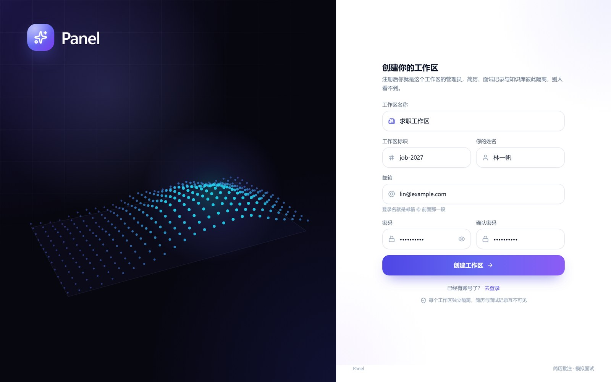
</p>

也可以直接调接口（注册即登录）：

```bash
curl -X POST http://localhost:8080/api/v1/auth/register \
  -H 'Content-Type: application/json' \
  -d '{"tenantCode":"myteam","tenantName":"My Team","email":"you@example.com","password":"<自己设一个强密码>","displayName":"张三"}'
```

登录名是邮箱 `@` 前面那一段（上面的例子即 `you`）。注册出来的是独立工作区：简历、面试记录、知识库按工作区隔离，重名或邮箱已被占用时接口返回 `409`，页面上会提示换一个标识。

### 6. 跑一遍主链路

登录后从「上传简历」开始：传一份 PDF → 等解析与批注 → 看批注 → 进编辑器改 → 「模拟面试」。

## 目录结构

```
Panel/
├── backend/
│   ├── pom.xml
│   └── src/main/
│       ├── java/com/panel/           领域分包（见上）
│       └── resources/
│           ├── application.yml       主配置（panel.* 前缀）
│           ├── application-dev.yml   本地开发配置
│           └── db/migration/         Flyway 迁移脚本
├── frontend/
│   ├── src/
│   │   ├── api/                      接口封装（含 SSE 消费）
│   │   ├── components/               编辑器、批注卡片、数字人、图表等
│   │   ├── pages/                    路由页面
│   │   ├── utils/                    Markdown 渲染、格式化
│   │   └── auth/                     当前用户与权限
│   └── public/resume-editor.html     编辑器 iframe 宿主
├── deploy/                           Dockerfile、compose、nginx、systemd、发布脚本
├── docs/                             设计文档与界面截图
├── scripts/                          迁移、回归、端到端脚本
├── docker-compose.yml
├── start-infrastructure.bat
├── start-backend-dev.bat
└── .env.example
```

## 几个关键设计

**简历双源。** 原件（`source_*` + 编辑层 `edit_layer`）与 Markdown 内容稿（`md_source_*`）分开存。Markdown 保存只移动内容稿指针，原件指针、文件类型、内容哈希都不动 —— 所以预览、原位编辑、PDF 导出全都不受影响；反过来走纯文本通路保存时会清掉内容稿，避免下次解析读回旧内容把用户刚存的东西盖掉。

**编辑层是一张字典。** `edit_layer` 是 `板块 index → 富文本 HTML`，落库在简历行上，换设备也能看到自己改过的版本；本地还有一层草稿，用来处理「服务器版本被别人改过」的冲突。

**解析是异步的。** 上传只负责落库并投递 `RESUME_PARSE` 任务，Worker 里做解析 + 批注，期间状态停在 `PARSING / ANALYZING`。同一份简历在解析中再次保存会拿到 `409`，避免两次解析互相覆盖。

**批注带锚点。** 每条批注既有原文引用（`quote`）也有字符级锚点（`blockId + start/end`），PDF 侧再用文本层把 `quote` 定位成页面矩形；定位失败就退回文本视图，不会让整页崩掉。

## 测试与回归

```bash
# 后端单元测试
cd backend && mvn test

# 主链路端到端：上传 → 编辑 → 高光定位 → 建面试 → 放弃 → 清理
node scripts/e2e-chain.mjs

# 完整一场面试（会真实调用模型，约 1 分钟）
node scripts/smoke-interview.mjs
```

脚本用环境变量控制目标与账号：

```bash
PANEL_BASE=http://127.0.0.1:8080 PANEL_USER=admin PANEL_PASS=****** \
  node scripts/smoke-interview.mjs
```

| 变量 | 作用 |
|---|---|
| `PANEL_BASE` | 后端地址，默认 `http://127.0.0.1:8080`（`e2e-chain.mjs` 默认 8081，按需覆盖） |
| `PANEL_USER` / `PANEL_PASS` | 登录账号；不传则用脚本里的默认值 |
| `PANEL_QUESTIONS` / `PANEL_FOLLOW_UPS` | 只对 `smoke-interview.mjs` 生效，控制题量与追问上限 |

## 更多设计文档

仓库里留了开发过程中的方案与手册，想深入某一块可以直接看：

| 文档 | 内容 |
|---|---|
| [简历分析与批注-开发计划](docs/简历分析与批注-开发计划.md) | 批注的数据结构与 PDF 定位方案 |
| [数字人面试官-开发计划](docs/数字人面试官-开发计划.md) | 数字人渲染、口型与语音链路 |
| [AI面试语音输入-设计方案](docs/AI面试语音输入-设计方案.md) | 流式 ASR 与前端按住说话 |
| [双库RAG架构与存储设计](docs/双库RAG架构与存储设计.md) | Elasticsearch + Milvus 的分工 |
| [部署与升级-运行手册](docs/部署与升级-运行手册.md) | 生产部署、发布与回滚 |

## 关于示例数据

README 中所有截图来自演示租户，简历内容为虚构人物（李想），电话、邮箱、GitHub 地址均为占位值，与任何真实个人无关。

---

<div align="center">
<sub>如果这个项目对你有帮助，欢迎提 Issue 或 PR。</sub>
</div>
