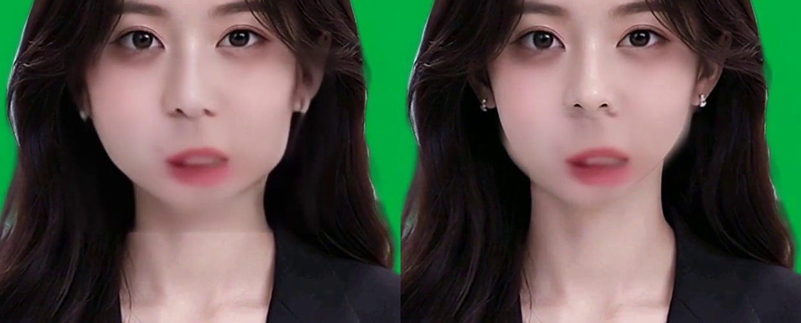

# MuseTalk 提速方案

> 基于 2026-11-13 在 RTX 4060 Laptop 8 GB 上的实测
> 同一段 6.65 秒中文音频、同一张底片、同一套权重

## 实测结果

| 配置 | 总耗时 | 相对实时 | 纯推理 |
|---|---|---|---|
| **默认**：fp32 + batch 6 | 278.3 s | 41.8× 慢 | 232 s |
| fp32 + batch 2 | 96.9 s | 14.6× 慢 | ~50 s |
| fp16 + batch 6 | 134.9 s | 20.3× 慢 | ~90 s |
| **fp16 + batch 2** | **57.7 s** | **8.7× 慢** | **~13 s** |

**两个开关叠加，快 4.82 倍。**

```
python -m scripts.inference ... --use_float16 --batch_size 2
```

## 1. `--use_float16`：2.06 倍，但默认是关的

`scripts/inference.py` 里这个参数是 `action="store_true"`：

```python
parser.add_argument("--use_float16", action="store_true", help="Use float16 for faster inference")
```

**不加就是全 fp32。** 官方 README 的示例命令里没有它，`inference.sh` 里也没有。

加上之后模型半精度化：

```python
if args.use_float16:
    pe = pe.half()          # whisper
    vae.vae = vae.vae.half()
    unet.model = unet.model.half()
```

4060 的 fp16 吞吐是 fp32 的两倍多，这一项几乎是白捡的。

**副作用**：极少数情况下 fp16 会在 VAE decode 产生轻微色偏。实测对比没看出差别，但如果你看到肤色异常，先怀疑这里。

## 2. `--batch_size 2`：1.68 倍，反直觉

8 GB 卡上 batch 越大越慢。batch=6 时显存吃到 95.5%（7,822 / 8,188 MB），GPU 被迫频繁换页，单步 11.04 秒；batch=2 时压力解除，单步降到 2 秒以内。

| batch | 显存峰值 | 单步耗时 |
|---|---|---|
| 6 | 7,822 MB（95.5%） | 11.04 s（fp32） / 2.76 s（fp16） |
| 2 | 明显更低 | — |

**默认值 6 是给 24 GB 卡调的。** 8 GB 卡上必须手动压到 2。

## 3. 后处理占了 35%

57.7 秒里有约 20 秒是 ffmpeg 干活：

```
Video generation command: ffmpeg -y -r 25.0 -f image2 -i ./results/v15/base-25fps_q1/%08d.png ...
Audio combination command: ffmpeg -y -i ../audio/q1.wav -i ./results/v15/temp_base-25fps_q1.mp4 ...
```

它把 125 张 PNG 写盘，再读回来编码成 mp4，然后再合一声音轨——**两次全量转码**。

改造点：用 `cv2.VideoWriter` 或 ffmpeg 管道直接吃 numpy 数组，省掉 PNG 落盘。预计能压到 5 秒以内，总耗时降到 **43 秒左右**。

这需要改 `scripts/inference.py` 的输出段，属于中等改动。

## 4. `--use_saved_coord` 必须开

不加这个，每帧都要跑 DWPose 检测人脸。固定机位下 125 帧的 bbox 完全一样，白算。

开了之后从 `{result_dir}/../{底片名}.pkl` 读坐标：

```python
import pickle
pickle.dump([(270, 110, 690, 670)] * 125, open('base-25fps.pkl', 'wb'))
```

**注意**：这个 pickle 会被自动删掉（跑完清理），下次跑之前要重建。我第一次测 batch=1 失败就是因为这个——pickle 没了，代码回退到 mmpose，而 mmpose 没装，直接崩在 `inference_topdown is not defined`。

## 5. 还没试的

| 手段 | 预期 | 成本 |
|---|---|---|
| TensorRT 引擎 | 2~3× | 编译数小时，算子兼容性风险 |
| `torch.compile` | 1.2~1.4× | Windows 上缺 Triton，大概率失败 |
| 换 Wav2Lip（95M 参数 vs 860M） | 5~10× | 画质明显下降 |
| A10 云卡 | 3× | 租金 |

如果 `--use_float16 --batch_size 2` 已经把 8.7× 压到可接受，就不用碰上面这些。

## 6. 8.7× 意味着什么

```
6.65 秒音频 → 57.7 秒生成
10 秒音频   → 87 秒生成
```

**实时对话仍然不可能**（25 fps 需要 40× 以上）。

但**异步预生成变得可行了**：用户答题通常 30~60 秒，而一句追问 87 秒——还差一点，但加上第 3 项的 ffmpeg 优化（43 秒）就刚好卡进窗口。

这是唯一能兼顾「口型真实」和「追问不预设」的路径，全部在本地跑，不用云卡。

## 复现命令

```powershell
cd tmp\musetalk\MuseTalk

# 每次跑之前重建坐标（会被自动删除）
D:\python\python.exe -c "import pickle; pickle.dump([(270,110,690,670)]*125, open('base-25fps.pkl','wb'))"

D:\conda-envs\MuseTalk\python.exe -m scripts.inference `
  --inference_config configs/inference/local-test.yaml `
  --unet_model_path models/musetalkV15/unet.pth `
  --unet_config models/musetalkV15/musetalk.json `
  --version v15 --fps 25 `
  --use_saved_coord --use_float16 --batch_size 2 `
  --ffmpeg_path D:\java\project\full-project\Nova AI\tmp\musetalk\bin `
  --result_dir ./results
```

## 7. 下巴接缝：已修复

原方案缺 `79999_iter.pth`（BiSeNet 人脸分割权重）时降级成矩形遮罩，导致下巴到脖子有一条横向色带。

### 权重找到了

Google Drive 拉不动，但 HuggingFace 上有镜像：

```
https://hf-mirror.com/vivym/face-parsing-bisenet/resolve/main/79999_iter.pth        (51 MB)
https://hf-mirror.com/vivym/face-parsing-bisenet/resolve/main/resnet18-5c106cde.pth (45 MB)
```

另一个可用源：`AI2lab/face-parsing.PyTorch`（也有 `79999_iter.pth`）。

### 修复效果



左边矩形遮罩，右边 BiSeNet 分割。色带消失，下颌线自然过渡到脖子。

### 代价与优化

| 配置 | 耗时 | 接缝 |
|---|---|---|
| 矩形遮罩 | 57.7 s | ❌ 有 |
| BiSeNet 每帧重算 | 141.9 s | ✅ 无 |
| **BiSeNet + 遮罩缓存** | **74.4 s** | ✅ 无 |

BiSeNet 每帧要跑一次前向，直接把总耗时从 57.7 秒推到 141.9 秒。

但固定机位下，裁剪框和原始人脸完全一致，**遮罩只取决于人脸轮廓、与嘴型无关**，所以整段视频共用第一帧的结果就够：

```python
_SEG_CACHE = {}

def face_seg(image, mode="raw", fp=None):
    if fp is None:
        return Image.new("L", image.size, 255)
    key = (image.size, mode)
    if key in _SEG_CACHE:
        return _SEG_CACHE[key]
    seg_image = fp(image, mode=mode).resize(image.size)
    _SEG_CACHE[key] = seg_image
    return seg_image

def clear_seg_cache():
    _SEG_CACHE.clear()
```

**换底片/换机位必须调 `clear_seg_cache()`**，否则会沿用上一个人的下颌线。

省下 67.5 秒，最终 74.4 秒。

### 最终数字

| 指标 | 值 |
|---|---|
| 6.65 秒音频总耗时 | **74.4 秒** |
| 相对实时 | 11.2× 慢 |
| 相对最初默认配置 | 快 3.74 倍 |
| 画质 | 接缝已修 |

```
6.65 秒追问 → 74.4 秒
10 秒追问   → 112 秒
```

去掉后处理那 20 秒（第 3 项）后约 **54 秒 / 82 秒**。

用户答题通常 30~60 秒，加上口语化追问通常 5~8 秒——**82 秒仍偏慢，但已经进入"可以靠答题时间掩盖"的区间**。
