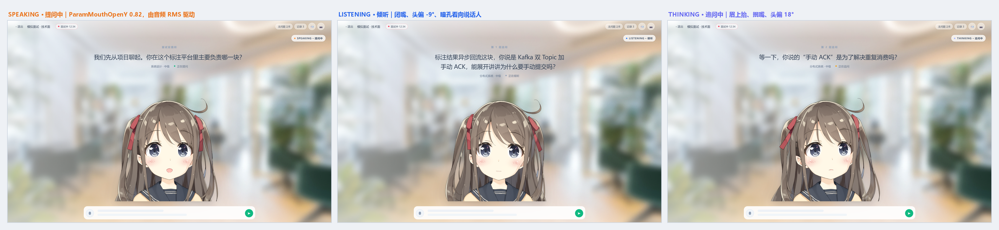

# 数字人面试官 开发计划（绿幕视频 + 实时口型）

> 目标：把现有「一张静态照片 + 呼吸动画」的面试官，升级成会说话、会倾听、能对上口型的数字人。
> 前提：**不推翻现有 TTS 与面试流程**。视频层只作为「表现层」插进 `DigitalInterviewer` 这一层，上层业务代码不动。

---

## 1. 现状（已核查）

| 事实 | 位置 |
|---|---|
| 面试官当前是静态图 + 0.6% 呼吸缩放 | `frontend/src/components/DigitalInterviewer.tsx`（prop 只有 `lifted`） |
| 素材 | `frontend/public/interviewer/base.webp`、`room.webp` |
| TTS 播放器：`speak/stop/unlock/muted`，`AudioBufferSourceNode` 直连 `destination` | `frontend/src/hooks/useInterviewerSpeech.ts` |
| TTS 插入点：`source.connect(context.destination)` 一行，`AnalyserNode` 可在此插入 | 同上 |
| 页面挂载点 | `frontend/src/pages/InterviewPage.tsx:482`（`<DigitalInterviewer lifted={!completed} />`） |
| 阶段枚举与文案 | `InterviewPage.tsx:35`（`PHASE_TEXT`）、`:206`（`phase` 计算） |
| 多帧口型方案已被否决（AI 生成帧对不齐） | `frontend/public/interviewer/README.md` |
| 本机 GPU | RTX 4060 Laptop **8 GB**，驱动 566.24 |
| Python | 3.12.10（**MuseTalk 要 3.10**）；conda 在 `D:\anaconda`；无 torch |
| 磁盘 | D 盘空闲 75 GB（需约 6 GB） |
| MuseTalk | **未安装** |

---

## 2. 素材清单（已验收）

即梦生成的 4 条原始视频，规格与可用性如下：

| 文件 | 时长 | fps | 分辨率 | 背景 | 口型 | 结论 |
|---|---|---|---|---|---|---|
| `2428` | 5.02 s | 24.12 | 960×960 | **全片绿幕** `#56D062` | 闭嘴（眨眼+一次点头） | ✅ **倾听态正式素材** |
| `4845` | 10.02 s | 24.06 | 960×960 | 前 2.5s 木纹，之后绿幕 `#54D75D` | 3s 后开始说话 | ✅ 说话底片（取 3.2s 之后） |
| `6351` | 10.02 s | 24.06 | 960×960 | 木纹（咖啡馆） | 前 3s 闭嘴，之后说话 | ❌ 抠不干净，弃用 |
| `3854` | 10.02 s | 24.06 | 960×960 | 木纹（咖啡馆） | 全程闭嘴+轻微点头 | ❌ 背景不可抠，弃用 |

已产出的成品（放在 `tmp/live2d-web/`，验收后迁到 `frontend/public/interviewer/`）：

| 文件 | 体积 | 时长 | 尺寸 | 说明 |
|---|---|---|---|---|
| `listen-loop.webm` | 435 KB | 9.95 s | 620×540 | VP9 + alpha，ping-pong 无缝循环 |
| `speak-alpha.webm` | 475 KB | 6.6 s | 620×540 | VP9 + alpha，**口型待重驱动** |

页面验证：`tmp/live2d-web/page-interviewer.html?s=listen|speak`（已完成，两个状态均正确叠合成景，无矩形边界/绿边/水印）。


### 2.1 生产命令（已跑通，参数不可随意改）

```bash
# ① 绿幕抠像 + 裁水印 + 缩放（2428 → 倾听素材）
ffmpeg -i 2428.mp4 \
  -vf "crop=960:836:0:0,chromakey=0x56D062:0.08:0.03,despill=type=green:mix=0.8,scale=620:-1" \
  -fps_mode passthrough -pix_fmt rgba seq-fwd/f%04d.png

# ② Python 拼 1..N + N-1..2（ping-pong，脚本见 tmp/live2d-web/pingpong.py）
# ③ 从序列编码（必须带 format=yuva420p）
ffmpeg -framerate 24.12 -i seq-loop/f%04d.png -vf format=yuva420p \
  -c:v libvpx-vp9 -pix_fmt yuva420p -crf 34 -b:v 0 -auto-alt-ref 0 -an \
  listen-loop.webm
```

四个**踩过的坑**，写进脚本注释，别再犯：

1. **绿幕色每条都不一样**：2428 是 `#56D062`，4845 是 `#54D75D`。用标准 `#00B140` 抠，人物会整片半透明。
2. **ffmpeg 9 删掉了 `-vsync`**，改 `-fps_mode passthrough`。不加这参数，5.02s 的视频会被容器声明的 60 tbr 填成 **303 帧**（真实 121 帧）。
3. **`reverse` + `concat` 会丢 alpha**：即使中途加 `format=yuva420p`，重编码后 alpha 也消失。必须走「PNG 序列 → 拼 → 编码」。
4. **`ffprobe` 看不到 VP9 的 alpha**，一律报 `yuv420p`。判断 alpha 只能在浏览器里实测。

---

## 3. 技术路线决策

### 3.1 为什么放弃 Live2D

前一轮已实测：用官方 Hiyori 模型在真实页面里渲染了 SPEAKING / LISTENING / THINKING 三态，口型用 `ParamMouthOpenY` 可精确驱动。

**否决原因不是技术，是画风**：二次元立绘在面试场景里是「虚拟主播」的视觉语汇，会削弱专业感。且现有产品线已经是写实照片人像，两者不能混用。



> 保留价值：Live2D 可做成「校园版/练习模式」皮肤，学生向场景里是加分项。正式面试页不做。

### 3.2 为什么是「绿幕视频 + MuseTalk」而不是纯静态

| 方案 | 活人感 | 口型 | 成本 |
|---|---|---|---|
| 静态图 + 呼吸（现状） | 低 | 无 | 0 |
| 视频循环（本次已做） | **高**（眨眼/微表情/点头） | 无 | 0（素材已出） |
| 视频 + 音频驱动口型 | 高 | **对齐** | 一次性 GPU 投入 |

视频循环已经解决了「像个活人」的问题（这是用户最直接的反馈点）；口型是第二阶段的问题。

### 3.3 状态机与生成策略

关键区分：**固定话术** vs **动态追问**。

```
固定话术（开场白、"我们换个方向"、"你还有什么想问我的"、"面试结束"）
    → 离线预生成，CDN 静态文件，0 延迟

动态追问（LLM 依据上一轮回答现生成）
    → 必须实时，MuseTalk realtime 模式，首帧 1~3s
    → 等待用「思考中」循环填充（2428 里视线下移的那 1.2 秒）
```

真实延迟链路（估算，M0 实测校准）：

```
用户说完
  ↓ 流式 ASR 收尾        0.2~0.5s
  ↓ LLM 生成追问文本      1~2s
  ↓ TTS 合成音频          0.5~1s
  ↓ MuseTalk 实时首帧      1~2s
面试官开口                 合计 3~5s
```

这 3~5 秒不是「加载」，是「她低头想了一下」——正好是真人面试官的动作。

### 3.4 不做的部分

- 不做 Live2D / 3D 数字人（画风不符）。
- 不做纯前端口型合成（照片网格变形精度不够，且需要手工标关键点，收益低于成本）。
- 不在 Java 后端跑模型（语言栈不匹配，单独 Python 服务）。
- 不做实时视频推流（WebRTC/HLS），先用 HTTP 拿整段 webm 播放——面试场景一句话 6 秒，没必要流式。
- 不做多形象并行（每套形象要重新生成全量题库，成本线性叠加，先锁 1 套）。

---

## 4. 分阶段计划

总工期约 **11 个工作日**。M0 有硬性决策门，不通过就回退（见 §6）。

### M0 · 环境与基准测试（2 天）

| 任务 | 产出 |
|---|---|
| conda 建 `MuseTalk` 环境（py3.10），装 torch 2.0.1+cu118、mmcv 2.0.1、mmpose 1.1.0 | `scripts/musetalk/setup.ps1` |
| 下载权重（MuseTalk 1.5 / sd-vae / whisper / dwpose / face-parse / syncnet）约 3.6 GB | `models/` 目录树 |
| 素材预处理：`2428.mp4` → 25 fps（训练就是 25fps，不转会有节奏误差） | `assets/2428-25fps.mp4` |
| 跑第一条：用一句真实追问的 TTS 音频 + `bbox_shift -5` | `out/speak-test.webm` |
| **掐表**：模型加载 / 首帧 / 25fps 是否跟得上 | `docs/数字人-基准测试.md` |

**验收标准**：输出视频里嘴型与该句音频可见对齐，牙齿不过度模糊，无逐帧抖动。

**决策门**：若口型主观质量低于「静态图 + 呼吸」，**停止投入，回退方案 B**（见 §6）。

### M1 · 单句管线脚本化（2 天）

| 任务 | 文件 |
|---|---|
| 输入 `(音频, 底片)` → 输出 `webm` 的一条命令 | `scripts/musetalk/dub.ps1` |
| 绿幕色自动采样（不再硬编码） | `scripts/musetalk/keycolor.py` |
| 抠像 + despill + 裁水印 + 缩放 + 编码，串成一步 | `scripts/musetalk/postprocess.ps1` |
| ping-pong 无缝循环生成器（从 `tmp/live2d-web/pingpong.py` 规范化） | `scripts/musetalk/loop.py` |
| 批量：读 `questions.json`，逐条生成到 `out/{qid}_{variant}.webm` | `scripts/musetalk/batch.py` |

**验收标准**：一条命令输入音频、输出 `frontend/public/interviewer/` 下可直接用的 webm。

### M2 · 前端组件（2 天）—— ✅ 已完成 2026-11-12


| 文件 | 动作 |
|---|---|
| `frontend/src/components/VideoInterviewer.tsx` | **新增** — 双 video 状态机、能力探测、降级 |
| `frontend/src/components/DigitalInterviewer.tsx` | 改 — `LIFTED_BOX` / `FINISHED_BOX` 改为 `export`，两条路线共用同一份落位 |
| `frontend/src/pages/InterviewPage.tsx` | 改 — 引用换成 `VideoInterviewer`，传入 `phase` |
| `frontend/public/interviewer/` | 新增 `listen-loop.webm` / `speak-alpha.webm` / `fallback.png` + README 重写 |

实际实现（与计划的差异）：

| 项 | 结果 |
|---|---|
| 双 video 状态机 | ✅ 倾听视频常驻播放，仅切 `opacity`，永不 `pause()` |
| 240ms 交叉淡入 | ✅ `transition-opacity` + `transitionDuration` |
| `onended` 淡回监听 | ✅ 已实现，但当前 `speak-alpha.webm` 是 `loop` 的，走不到；`phase` 离开 `SPEAKING` 时由 effect 切回 |
| Safari / iOS / 省流降级 | ✅ 一律退到 `DigitalInterviewer`（静态图 + 呼吸） |
| 「思考中」独立循环 | ⏸ 暂用 `listen-loop.webm`（`THINKING` 与 `LISTENING` 同画面），素材够用，M1 之后再拆 |

**实测（真实 app，session #26）**：

```
点击前      listen: playing opacity 1 (t=3.0)   speak: paused opacity 0
+2.5s      listen: playing opacity 0 (t=7.0)   speak: playing opacity 1 (t=3.3)
+12.5s     listen: playing opacity 1 (t=8.1)   speak: paused  opacity 0
```

`tsc --noEmit` 与 `vite build` 均通过（2119 modules / 7.02s）。

#### 2026-11-12 修复：循环里闪过不透明方块

首版上线后肉眼可见「人物背后每轮闪一下」。逐帧查 alpha 找到根因：**即梦素材的片头片尾是淡入淡出，绿幕还没铺满，`chromakey` 抠不掉**。

| 帧号（原始 121 帧） | 透明率 | 结果 |
|---|---|---|
| 1–2 | **0.0%** | 完全实心 → 叠上去是一块不透明方块 |
| 3–11 / 111–121 | 9.5% → 24.6% | 抠不干净 → 半透明残影 |
| 12–110 | 44.4% ~ 45.2% | ✅ 干净 |

`4845`（说话素材）同样中招，从 3.2 s 切入的头 11 帧全不干净，必须从 **3.78 s** 开始。

修复三步：① 用 `-ss 0.55 -t 4.0` 裁到干净段；② 新增 `check_alpha.py` 当守门员，任何帧透明率 < 35% 直接报错；③ ping-pong 拼完**再查一次**（拼接会把首尾帧翻倍）。

修复后：`listen-loop.webm` 190 帧、`speak-alpha.webm` 142 帧，透明率全部 44.1%~45.2%。页面内用 canvas 逐帧采样顶部两角，131 帧全过，**最大 alpha = 0**。

> 教训：`ffprobe` 和动图预览都看不出这个问题（前者不报 alpha，后者抽帧时刚好避开）。只有**逐帧统计透明率**或**在浏览器里逐帧读像素**能发现。

### M3 · 后端微服务 + Java 对接（3 天）

新增独立服务 `services/muse-service/`（Python / FastAPI），不改现有 Java 业务代码，只加一个调用方。

```
POST /generate   { audio_url, avatar, bbox_shift }  → { task_id }
GET  /task/{id}  → { status: queued|running|done|failed, video_url }
GET  /health     → { gpu, vram_free, model_loaded }
```

| 任务 | 说明 |
|---|---|
| 常驻进程 + 模型预热 | 启动即加载，避免每请求 60~120s 冷启 |
| 单 worker 串行队列 | 4060 单卡，并发无意义；用 `asyncio.Queue` 即可，不引 Celery |
| 缓存 key = `sha256(音频字节) + avatar + bbox_shift` | **不能用题目 ID**：TTS 有随机性，同题不同音频会永久不命中 |
| Redis 缓存 + 结果落 OSS | 命中直接返回 URL，不触发推理 |
| Java 侧：`MuseClient`（`RestTemplate` + 超时 10s + 失败降级为纯音频） | `backend/**/interview/MuseClient.java` |
| 失败降级 | 生成失败/超时 → 前端只播 TTS 音频 + listen 循环（没人看得出少了口型，因为没声音时她本来就不该动嘴） |

**验收标准**：一次完整面试（8 题 + 3 次追问）跑通；缓存命中率 > 80%；服务挂掉时面试流程不中断。

### M4 · 部署与预热（2 天）

| 任务 | 说明 |
|---|---|
| GPU 节点镜像 | `docker/muse-service.Dockerfile`（CUDA 11.8 base + 权重层） |
| 批量预热脚本 | 题库 × 固定话术全量预生成，跑一晚上 |
| 监控 | `/health` 上报显存、队列深度、平均生成耗时 |
| 开关 | 配置项 `interview.digital-human.enabled`，异常时一键关回静态图 |

**验收标准**：新用户首次面试，固定话术 0 延迟；动态追问首帧 < 3s。

---

## 5. 接口契约

### 5.1 文件命名规范

```
frontend/public/interviewer/
├── listen-loop.webm          # 倾听循环（ping-pong，永久）
├── thinking-loop.webm         # 思考循环（1.2s）
├── fallback.png               # 首帧静态兜底
├── fixed/
│   ├── greeting-01.webm       # 固定话术，预生成
│   ├── transition-01.webm
│   └── closing-01.webm
└── dynamic/                   # 动态追问，服务端生成后回填
    └── {qid}_{hash8}.webm
```

### 5.2 组件 props

```ts
interface VideoInterviewerProps {
  lifted: boolean          // 作答条是否展开（沿用现有）
  phase: InterviewPhase    // SPEAKING | LISTENING | THINKING | IDLE
  videoKey?: string        // 指定播放的说话视频；缺省走固定话术池
  onSpeechEnd?: () => void // 视频播完回调，用于推进流程
}
```

---

## 6. 风险与回退

| 风险 | 概率 | 影响 | 应对 |
|---|---|---|---|
| **口型质量不达标**（牙齿糊、抖动、身份漂移） | 中 | 高 | M0 决策门；回退方案 B：只保留视频循环，放弃口型 |
| 4060 上实时推理跟不上 25fps | 中 | 中 | 降级为离线生成 + 「慢一拍」策略（上一句生成好、下一句用） |
| 即梦素材商用授权不明确 | 中 | 高 | **上线前必须确认**；否则换自建/授权素材 |
| MuseTalk 服务不稳定导致面试中断 | 低 | 高 | 配置开关 + 前端全链路降级到静态图 |
| 单卡并发瓶颈（多人同时面试） | 中 | 中 | 队列排队 + 前端「思考中」动画；超时降级为音频 |
| 绿幕素材重生成成本 | 低 | 中 | 已有 2 条可用；如需新形象，按 §2.1 命令复现 |

**回退方案 B（M0 不通过时）**：保留本次已产出的 `listen-loop.webm` + `speak-alpha.webm`，做成「视频循环 + 纯音频 TTS」的组合——用户听到声音、看到她在听（轻微点头/眨眼），不说话时嘴不动。**这在面试场景是可接受的**，因为用户答题时注意力在自己身上。

---

## 7. 成本

| 项 | 一次性 | 月度 |
|---|---|---|
| MuseTalk 代码与权重 | 0（MIT，权重明确允许商用） | 0 |
| 本地 4060 跑推理 | 0 | 0（电费） |
| GPU 节点（T4 16G 按需） | — | 150~1200 元（看常驻时长） |
| 对象存储 + CDN（1000 题 × 500KB） | — | < 50 元 |
| 即梦素材商用授权 | 待确认 | — |

**最省钱路径**：如果动态追问占比 < 20%，固定话术全预生成、动态追问降级为「音频 + 聆听循环」，则 **GPU 成本为 0**。

---

## 8. 交付物清单

```
docs/
├── 数字人面试官-开发计划.md      # 本文档
└── 数字人-基准测试.md            # M0 产出：实测延迟与质量结论

scripts/musetalk/
├── setup.ps1                    # M0：环境
├── dub.ps1                       # M1：单句生成
├── keycolor.py                   # M1：绿幕色采样
├── postprocess.ps1               # M1：抠像→编码
├── loop.py                       # M1：ping-pong
└── batch.py                      # M1：批量

frontend/src/components/
└── VideoInterviewer.tsx          # M2

services/muse-service/
├── app.py                        # M3：FastAPI
├── Dockerfile                    # M4
└── requirements.txt
```

---

## 9. 立即开始的第一件事

M0 的第一条命令，其余全部依赖它：

```powershell
conda create -n MuseTalk python=3.10 -y
conda activate MuseTalk
pip install torch==2.0.1 torchvision==0.15.2 torchaudio==2.0.2 --index-url https://download.pytorch.org/whl/cu118
pip install -r requirements.txt
mim install mmengine
mim install "mmcv==2.0.1"
mim install "mmdet==3.1.0"
mim install "mmpose==1.1.0"
```

跑通后立刻产出 `docs/数字人-基准测试.md`，里面只有三个数字：**模型加载耗时、首帧耗时、能否稳定 25fps**。这三个数字决定后面 9 天怎么走。
