# 知识库 · 刷题模块：业务设计说明

> 面向产品/业务视角，讲"这套东西怎么用起来、为什么这么设计"。
> 实现细节（算法参数、SQL、接口清单）在 [刷题与知识点联动.md](刷题与知识点联动.md)。
> 截图全部来自本机 dev 环境（2026-11-12，账号 admin）。

## 1. 一句话定位

把"面试资料"变成**可以自测、并且知道你为什么错**的东西。

传统的题库系统止步于"我做了 100 道题，正确率 70%"。这套模块多走一步：
**每道题都挂在一个知识点上**，所以答错时能把你送回对应的知识点，并且这个知识点的"能力值"会因为你的错误而下降，
下一次抽题时它更可能再出现。

```
面试资料（md/docx/pdf）
   ├── 题库：抽出题目 → 每题挂知识点 → 抽题 → 自评 → 能力值 / 错题本
   ├── 技术文档：切成切片 → 挂知识点 → 答错时的"回去看这里"
   └── 面试记录：每轮 skill + 得分 → 折算成知识点能力值
```

三个数据源最后都汇到同一张"知识点能力值表"上——这是整个模块的中枢。

## 2. 三种知识库，三种分工

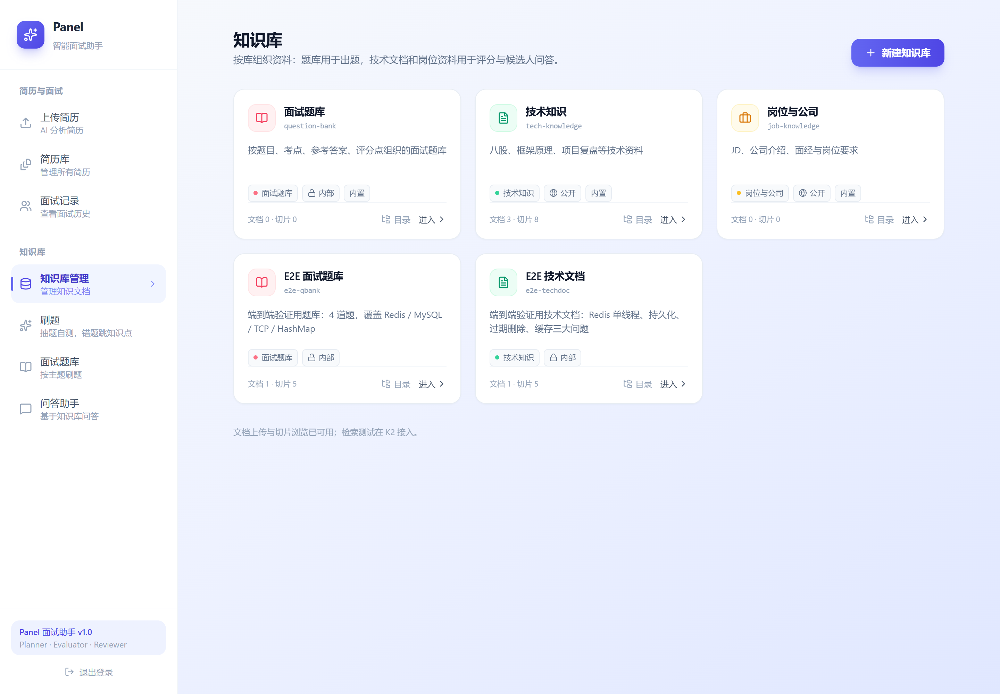

库的类型决定"上传的文档会被怎么处理"，不是单纯打标签：

| 类型 | 干什么 | 解析方式 | 抽题 |
|---|---|---|---|
| 面试题库 `QUESTION_BANK` | 出题、刷题 | 切片 + **抽题目** + 自动归类 | ✅ 只有它能抽题 |
| 技术知识 `TECH_DOC` | 答错时的知识点原文、面试官参考资料 | 按标题切片 | ❌ |
| 岗位与公司 `JOB_KNOWLEDGE` | JD、面经、面试评估结论 | 按标题切片 | ❌ |

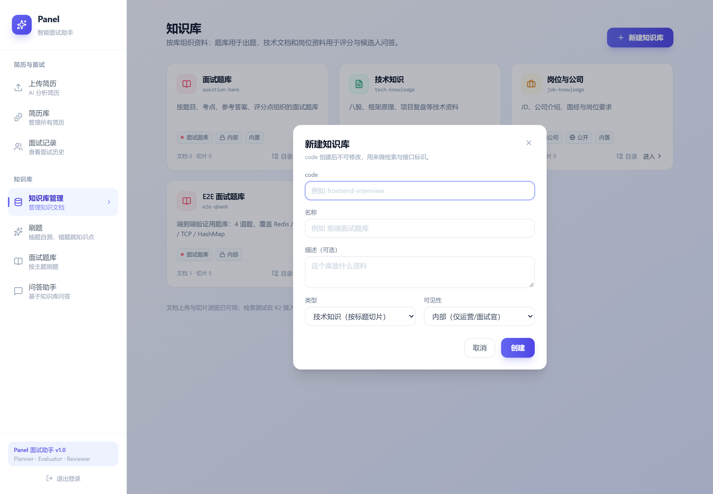

建库时选**类型** + **可见性**，`code` 建后不可改（要做检索/接口标识）。
可见性 `INTERNAL` 的库只有平台管理员/管理员/面试官能看见，候选人连库 id 都拿不到（列表接口直接过滤掉）。

## 3. 上传八股题库：一条文档进来，经过五道工序

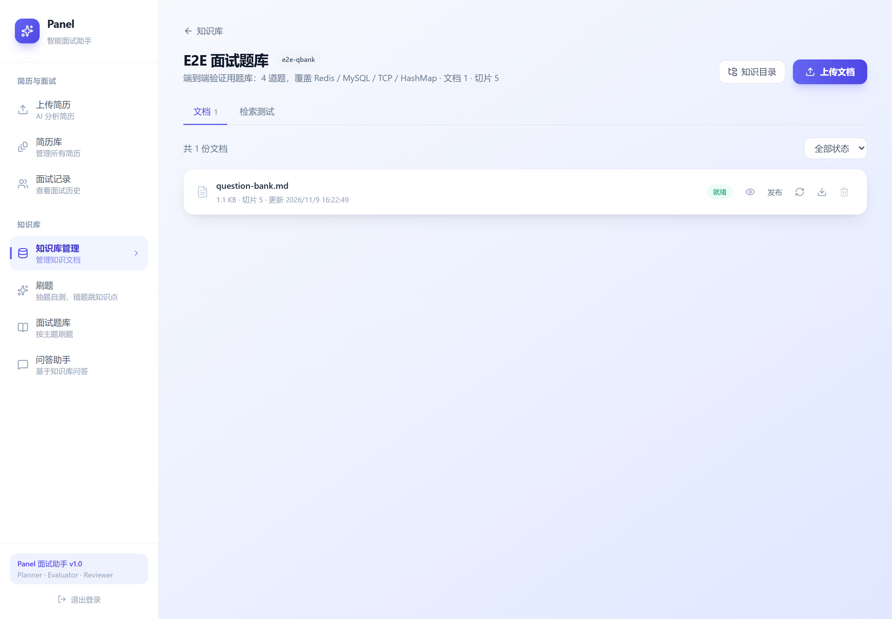

上传入口就一个「上传文档」按钮，但落库之后是异步流水线（上传即返回 202，页面轮询状态）：

```
1. 落库        ≤20MB / 单库 ≤500 份；同一库里内容 hash 重复直接拒（"该文件已存在"）
2. 解析        md / txt / html / pdf / docx（docx 先转 markdown 再解析结构，保住标题层级）
3. 切片        按库的 chunk 策略 + 大小/重叠切片，每片带 heading（这个 heading 是后面归类的线索）
4. 抽题目       仅题库：把切片正文按"1. / 2. / Q: / 问："这类编号切成一题一条，
               顺手识别 #标签、年份（2024）、以及"答案/答："分段
5. 自动归类     让模型在已有目录里给每题选一个知识点；没把握就退回关键词规则
               命中 ≥0.72 才自动落，否则留成"待确认"
```

状态机：`UPLOADING → PARSING → CHUNKED → INDEXING → READY`（失败进 `FAILED`，可以「重试」）。
重新上传同一份文档不会堆重复：同库 hash 去重；重新解析会**先清掉旧切片和旧题目的挂载**再重建。

## 4. 上传知识点：目录树是产品结构，不是文档目录

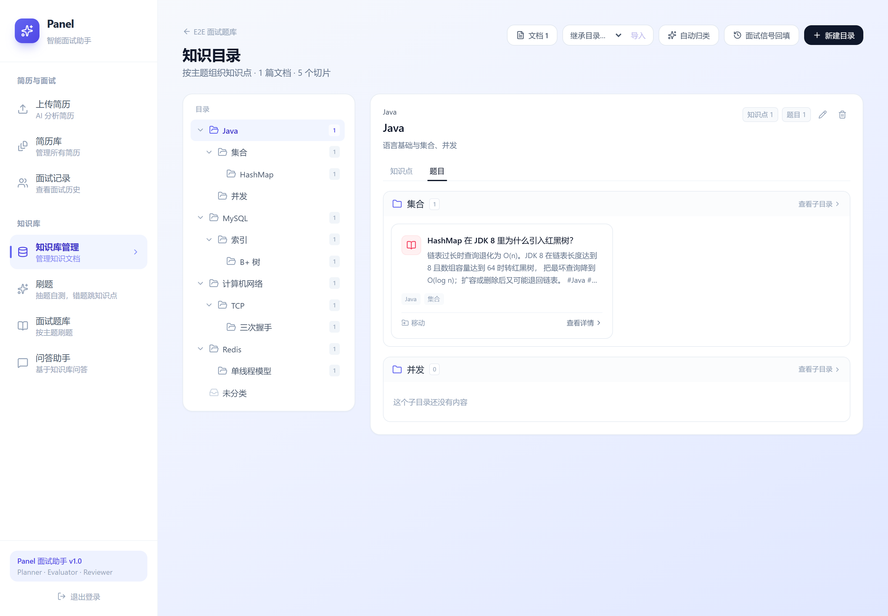

左边是树（最多 3 级），右边是节点内容：这个节点下挂了哪些题、哪些文档切片。

设计上的三个决定：

1. **树只有一棵，最多 3 级**。不做图。理由：产品的用法是"这次错了 → 回到哪个主题"，
   3 级树能回答；图能回答"这两个概念有什么关系"，但那是第二个产品问题（相关知识点），
   先用手工关系表 + 后续模型生成候选解决，不阻塞主线。
2. **节点可以空着**。空节点不是错误——它表示"这个主题我们还没整理资料"，
   覆盖率看板会把空节点标出来，作为运营的待办。
3. **人工动作永远优先**。人工挪过一次的题会被**锁定**（`locked`，置信度 1.0），
   之后自动归类不再碰它。这是全系统唯一的"人工真值"通道——也是风险点：
   挪错了系统会一直信错。

目录本身有三个来源：手动新建、从别的库「继承目录」（按 `path_key` 幂等复制）、LLM 自动建。

### 4.1 目录树就地改：不弹窗，直接在树上动

维护一棵 214 个节点的树，如果每次改名都要开弹窗、每次挪位置都要先「选中 → 点移动 → 选目标」，
运营一天就烦了。所以树本身是可编辑的，所有操作都在树上完成：


| 想要的 | 怎么操作 | 背后做了什么 |
| --- | --- | --- |
| 新建一级 / 子级 | 底部「新增一级目录」，或节点悬停后点 `＋`（第 3 级不再显示 `＋`） | `POST /kb/{id}/catalog/categories`，父节点自动展开 |
| 改名 | **双击节点名**，或悬停点铅笔；`Enter` 提交、`Esc` 取消 | `PATCH /kb/catalog/categories/{id}`，`path_key` 及整棵子树一起改，描述不动 |
| 换层级 | 把节点拖到目标节点**中间**（落进去当子级） | `POST .../move {parentId, beforeId}`，重算整棵子树的 `path/path_key/depth` |
| 调顺序 | 拖到目标节点的**上/下边缘**（出现横线即插到它前/后） | `POST .../move {parentId, beforeId}`，同级 `sort_no` 按 10 步长重排 |
| 删节点 | 悬停点垃圾桶 → 行内确认条 → `删除` | `DELETE .../categories/{id}?cascade=true` |

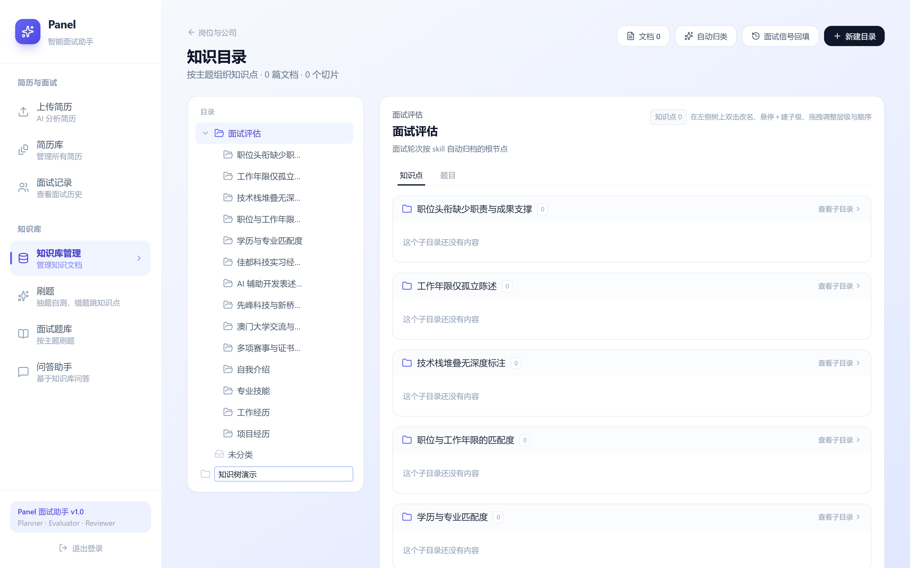

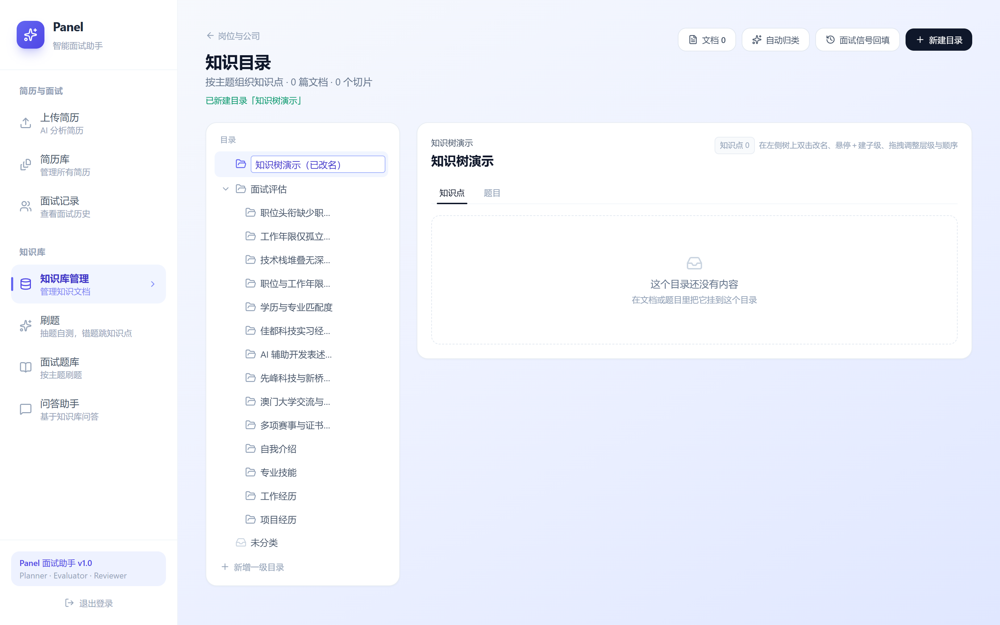


拖拽有三条硬约束，全都由后端兜住，前端只做提示：

1. **不能拖进自己的子树**（会成环）——前端算 `isDescendant` 直接不触发，后端另有 `path` 前缀校验；
2. **最多 3 级**——第 3 级节点不再提示「拖进去」；
3. **同级不能重名**——只在真正换父时才检查，纯排序不拦。

删除的口径是"删结构不删资料"：


- 不带 `cascade` 时，**只能删空节点**，否则返回 `先删除子目录` / `目录下还有内容，先移动或删除条目`；
- 带 `cascade=true` 时，整棵子树一起删，子树上的题目与切片**只摘挂载**回到「未分类」——
  文档还在、题目还在，只是不再属于任何主题；
- 「未分类」是虚拟节点（`id ≤ 0`、`system=true`），永远不可改名、不可删、不可往里拖。

> 顺手修掉的一个老坑：`move` 原来只改 `path/path_key/depth`，**没改 `parent_id`**。表现是"移进 A 再拖回根"
> 会被当成同父排序，节点看着还在原地。这次一并修正，并补了 `path_key` 随改名同步（否则 key 和名字长期对不上，
> 「继承目录」按 key 去重时会误判）。

### 4.2 上传了却没归类？页面会自己喊出来

实际踩到的坑：技术知识库导入 3 份文档、8 个切片，目录里却全是「知识点 0」——
不是没数据，是**自动归类没命中，内容全躺在「未分类」**，而页面上没有任何地方说这件事。

两处一起补：

**① 未归类条数摆在页头。** 进目录页先探一次「未分类」节点的条数（`GET /kb/catalog/categories/-1/items?type=...&limit=1`
拿 `total`），大于 0 就出黄条：

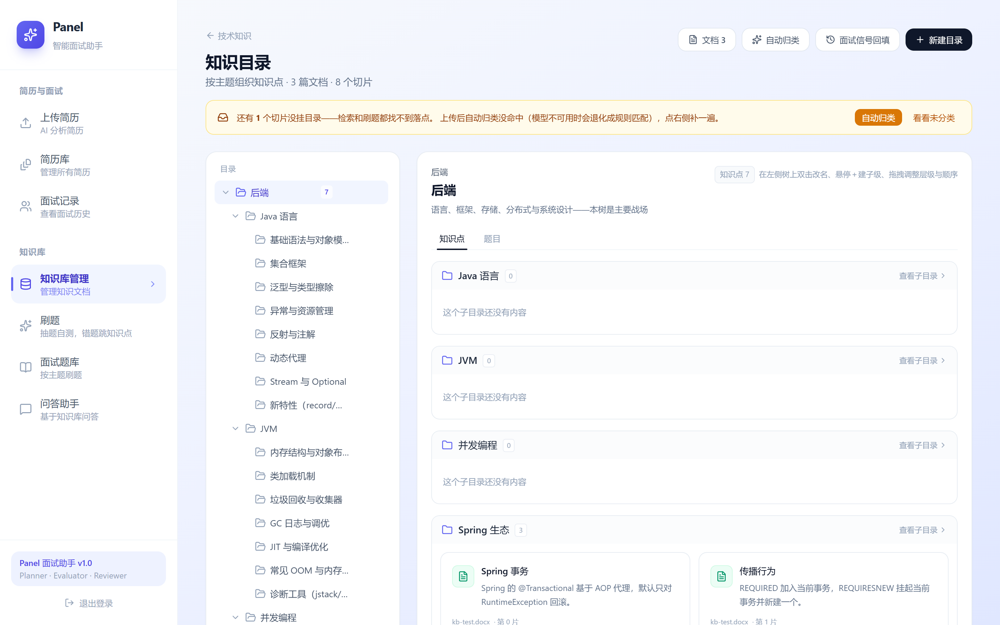

文案只讲两件事：「还有 N 个切片没挂目录」+ 会带来什么后果（检索和刷题找不到落点），右边两个动作——
`自动归类` 当场补一遍、`看看未分类` 直接把那 N 条列出来。归类完黄条自己消失。

**② 规则兜底认得带括号的节点名了。** 原来的规则只有两档：节点名整串出现在正文里（0.82）、
`path_key` 尾段整串出现（0.74）。而 v1 知识树里大量节点长这样：`持久化（RDB/AOF）`、`缓存（穿透/雪崩）`、
`Stream 与 Optional`——整串名字永远不会出现在正文，所以模型一挂，规则也救不回来，静默全部跳过。

现在多了一档**关键片段匹配**（`KbAutoClassifyService.fragmentScore`）：

- 英文技术词整词命中（`rdb` / `aof` / `kafka`）算一个片段；
- 中文按 2-gram 展开，命中即计数（`事务传播与失效场景` → 事务 / 传播 / 失效 / 场景 各自能命中）；
- `与/和/场景/处理/机制` 这类泛词进停用表，不参与计分；
- **命中 ≥2 个片段才给分**，`0.72 + 0.02×(命中数-2)`，上限 0.78；刚够 `AUTO_APPLY=0.72` 就能挂上。

实测：`redis 持久化…rdb…aof` 的切片对节点 `持久化（RDB/AOF）` 得 0.76；而只提到 kafka 一次的文本对同一节点得 0，
留在未分类。宁缺勿错的取舍——片段匹配是模型不可用时的"起点"，挂上的是**未锁定**的自动归属，
还能在目录里点「确认归属」变成人工真值。

### 4.3 自动挂的和人确认的，得能分清

自动归类挂上去的归属默认 `locked=false`：它是模型的判断，下次重传或重跑归类还会被重算。
以前这个状态在界面上完全不可见——题/切片挂在哪看得见，但"这条是模型猜的"看不出来，也就无从确认。

现在每个条目卡片右上角直接标出来：

| 状态 | 外观 | 含义 |
|---|---|---|
| 自动挂、没确认 | 琥珀色 `✓ 待确认 92%`（可点） | 模型/规则挂的，可信度写在脸上；点一下钉成人工真值 |
| 人工确认过 | 绿色 `✓ 已确认` | `locked=true`，自动归类不再覆盖 |
| 没挂 | 无徽标 | 只出现在「未分类」里，见 §4.2 |

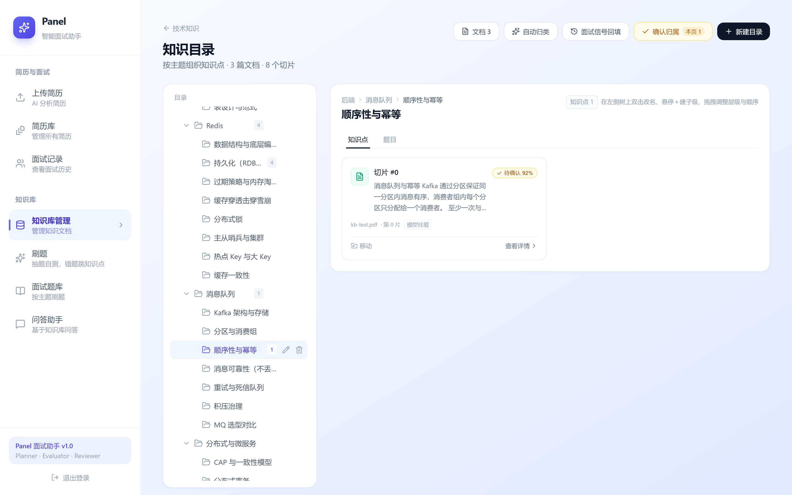

嫌一条条点太慢，页头有 `确认归属`：一次性把这个库里该类型所有"自动挂的、没确认过"的归属锁掉，
返回 `{confirmed, alreadyLocked}`，已确认的不重复写。按钮上带「本页 N」角标，当前页没有待确认的就变灰。

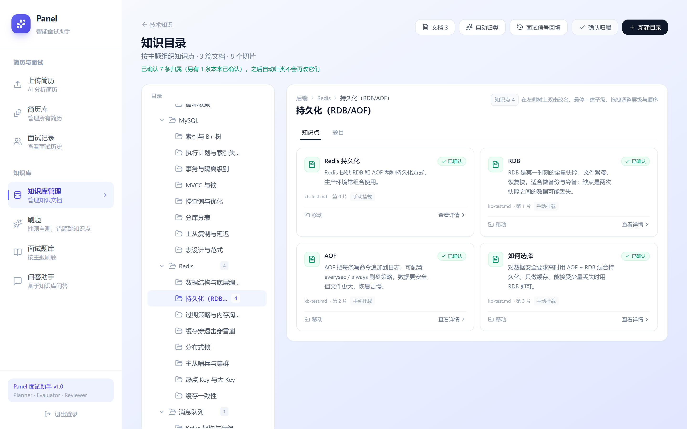

对应接口：`POST /kb/{kbId}/catalog/items/{itemType}/{itemId}/confirm`（单条）、
`POST /kb/{kbId}/catalog/items/confirm-all?itemType=CHUNK|QUESTION`（全库）。
条目 DTO 也补了 `categoryId / locked / confidence / linkSource`，卡片上的「模型挂载 / 规则挂载」来源标签就来自 `linkSource`。

> 别和 §4.2 的黄条混了：黄条说的是「**根本没挂**」（在未分类里），徽标说的是「**挂了但还没人确认**」。

### 4.4 自己当用户跑一遍：一份 8 题的文档，进来还剩几题

2026-11-12 拿一份自造的《Java 并发与 JVM 面试 8 问》走完整链路（列表 → 题库 → 上传 → 解析 → 归类 → 刷题 → 自评 → 知识点），按"新人第一次用"的视角记问题。走的顺序就是用户的顺序，所以下面这些坑只有在真跑一遍时才会露出来：

| 现象 | 根因 | 处理 |
|---|---|---|
| 8 题的 md 上传后只出 **3 题**，其中 1 题题干是文档标题 | Markdown 解析把有序列表的 `1.` `2.` 前缀**剥掉**了，题目只能靠"这行像不像问题"猜 | `DocumentParserRegistry` 保留编号行原文 |
| 题目跨切片就丢：切成 4 片后题目数随切片大小变化 | `KbQuestionParser` 逐切片拆题，切片是检索单位、题目是业务单位，粒度错配 | 新增 `parse(整篇正文, chunks)`：先按整篇拆题，再用题干反查落在哪一片 |
| 每题都带着 `Java/并发/JVM/MySQL/Redis/消息队列` 全套标签 | 标签从**整篇**扫，文档末尾那行 `#Java #Redis` 被撒给每一道题 | 标签只扫这道题自己的段落 |
| 页面显示「做过 13 / 题库总题数 8」 | 重传文档删掉旧题后，孤儿作答还留在 `kb_quiz_attempt` | `countDistinctQuestions` 加 `exists` 约束，只算题库里还在的题 |
| 刷题页报 `请求失败（HTTP 500）`、后端进程随后消失 | `AsyncJobDispatcher.pollOnce` 整个方法在一个事务里，handler 内部（简历解析）抛异常被自己 catch 后事务已被标 rollback-only，提交时抛 `UnexpectedRollbackException` 到调度线程顶层 | 事务只包"领取任务"（`TransactionTemplate`），handler 跑在事务外并整体兜住异常；`ResumeParseWorker` 的重试入队也自兜 |
| 空题库的覆盖率报 100% | `total == 0 ? 1d` | 改成 0，没有题目谈不上覆盖 |

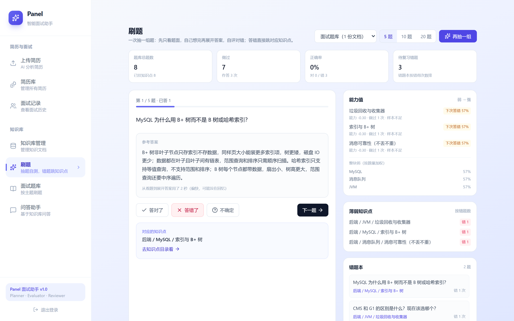

走完这一遍，链路是通的：`上传 → 8/8 出题 → 归类到 消息队列/消息可靠性（不丢不重）→ 抽 5 题只给题面 → 展开答案 → 自评"答错了" → 卡片给出「后端 / JVM / 垃圾回收与收集器」并带「去知识点目录看 →」，右侧能力值同步到"下次答错 57%"`。

同时确认了**空题库的空态是清楚的**：`上传第一份文档` 是唯一主按钮，支持格式和 20MB 限制直接写在下面。

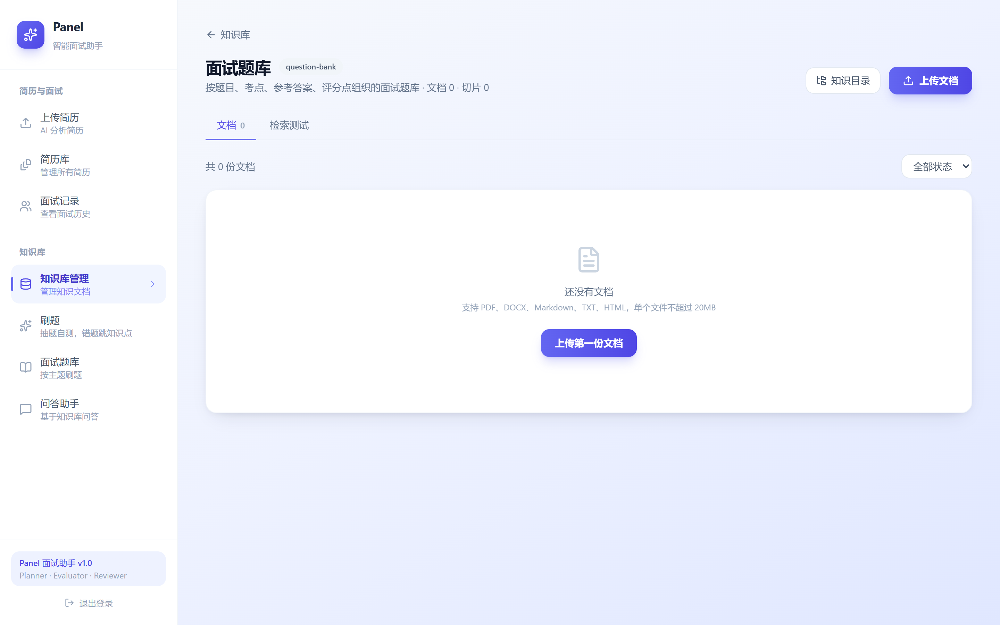

还留着的小账：

- `classify` 返回的 `llmApplied` 是"喂给模型的批次数"，和实际挂上的条目数对不上（8 题报 12），页面上会让人以为多挂了；
- 首屏加载完之前统计区显示 0、按钮灰着，没有骨架态，网络慢时像"库是空的"；
- 导航里「知识库管理 / 刷题 / 面试题库 / 问答助手」四项指向两块内容，第一次进来不容易判断点哪个。

顺手一起收拾掉的：

- **僵尸会话**：重传文档删掉旧题后，旧会话只剩「（题目已删除）」，`stats.recentSessions` 现在直接跳过"一道活题都没有"的会话；
- **空题库不该能点「开始刷题」**：原来点下去只得到一句后端报错（`CONFLICT 题库里还没有题目…`），现在按钮置灰并把原因写在空态里——「先去「知识库管理 → 面试题库」上传题库文档」。

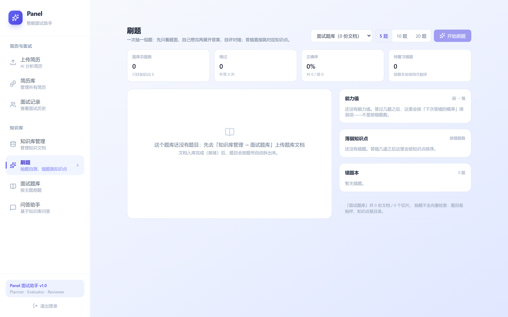

清理测试数据时也验证了删除语义：删文档会把切片、题目、目录链接一起带走（`chunk 4 → 0`、`question 8 → 0`、`link 12 → 0`），题库的 214 个目录节点原样保留——删资料不删结构。
但 `kb_quiz_session` / `kb_quiz_attempt` / `kb_skill_state` 会留下来，需要单独清。


## 5. 覆盖率：这个模块唯一真正硬的指标

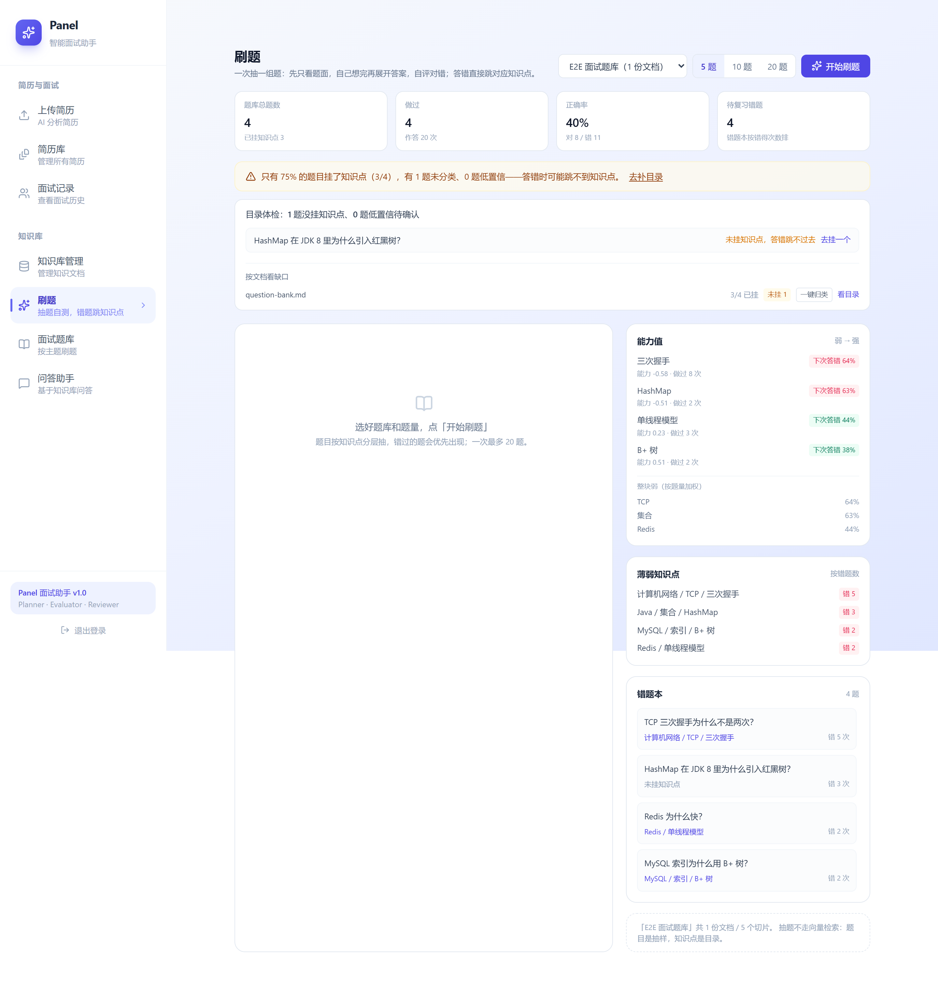

告警条：`只有 75% 的题目挂了知识点（3/4），有 1 题未分类、0 题低置信——答错时可能跳不到知识点。`

为什么把覆盖率当第一指标：**题目没挂知识点，答错时就跳不回去**，
"我记得没错"就退化成"我又错了"，整个产品的价值主张断掉。

「目录体检」就是这个指标的操作台：

- **逐条**：每题一行，`确认归属` / `改挂` / `去挂一个`；
- **批量**：`全部确认（N 条）`；
- **按文档**：每份文档显示 `已挂/总数`、`未挂 N`、`待确认 N`，后面一个 `一键归类` 按钮——
  有「待确认」时按"清掉低置信再重跑"的口径执行，没有就只补未挂的。

## 6. 刷题闭环：五步，没有一步是随机装饰

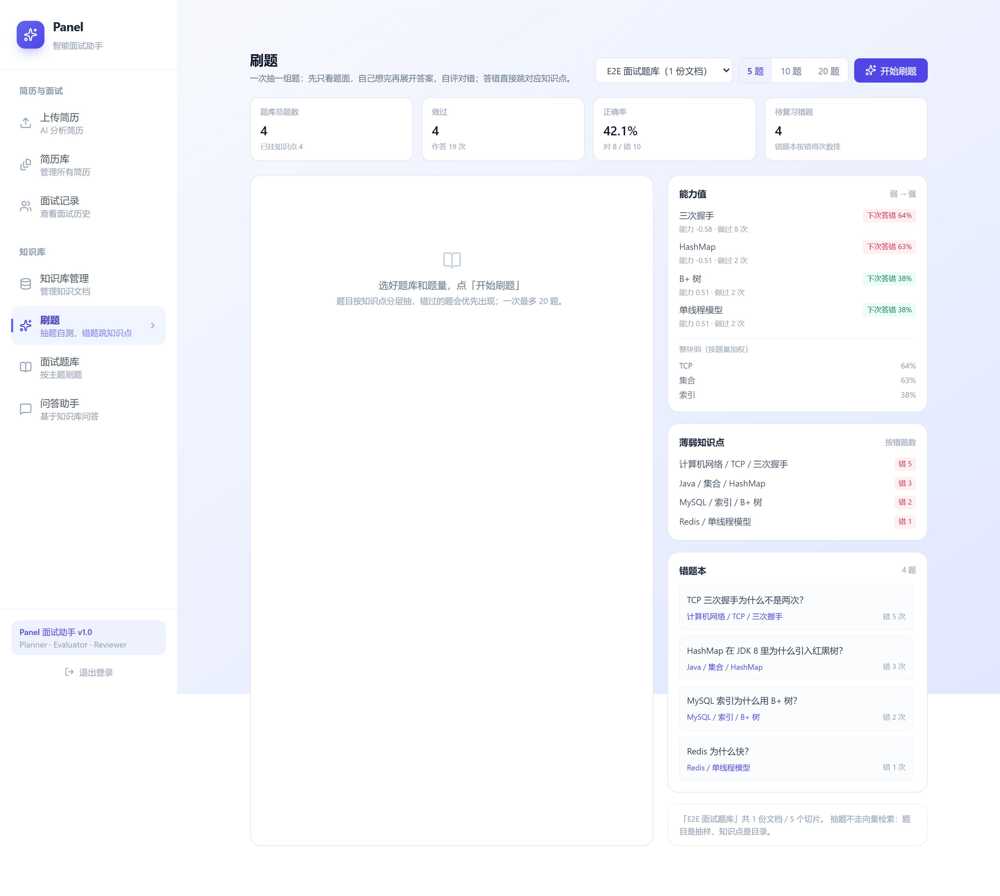

**第 1 步 · 抽题（分层 + 加权）**

- 按主知识点**分桶**，桶之间**加权抽**，权重 = 桶内最弱那道题的权重；
- 单题权重来自能力值：`0.3 + 3.0 × 答错概率^1.5`，再乘近期因子（近 3 天错过 ×1.5、近 3 天做对 ×0.25）；
- 一个桶最多给 2 个名额，保证 5 题不会全砸在同一个弱节点。

实测（同一个库抽 40 次）：最弱节点的出场率从旧逻辑的 5% 提到 25%，
"最近错的那道题"从 80% 降到 52%——弱项被摊开，而不是被一个瞬时错误绑架。

**第 2 步 · 只看题面**

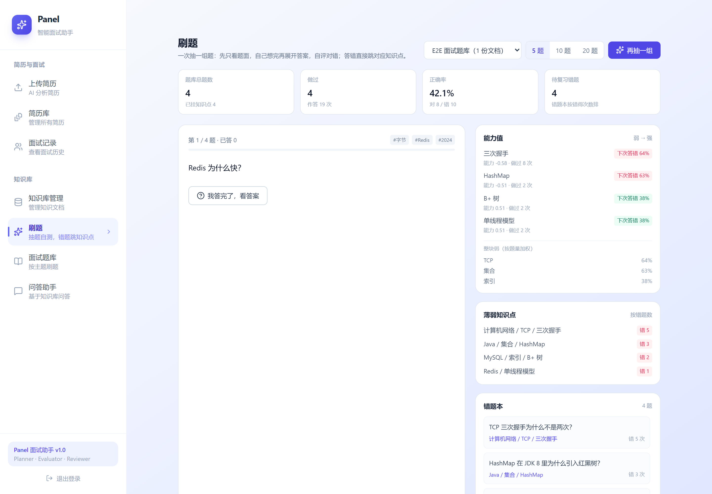

抽题接口返回的 `items` **不含答案**，连题目列表接口都不返回 `answer`。
不是前端不显示，是后端不下发——看过答案的题再做一遍，测的是记性不是理解。

**第 3 步 · 展开答案**

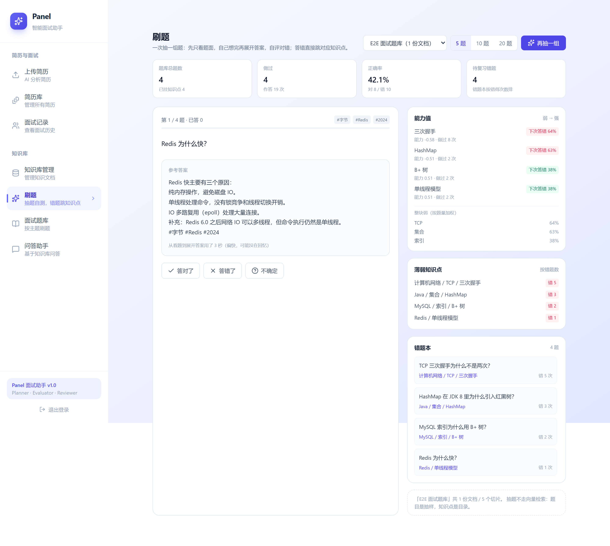

展开答案时记录 `revealed_at`，于是有一个副产品：`从看题到展开答案用了 3 秒（偏快，可能没在回忆）`。
这个数字不影响对错判定，只用来提示"你是在回忆还是在翻答案"。

**第 4 步 · 自评（对 / 错 / 不确定）**

不做自动判分：面试题是开放题，自动判分只会制造噪音。自评反而是最准的信号。
- 正确率 = 对 / 已作答（「不确定」进分母、不算对）；
- 错题本把「不确定」也算错题——"没答对"就该复习。

**第 5 步 · 答错 → 回到知识点**

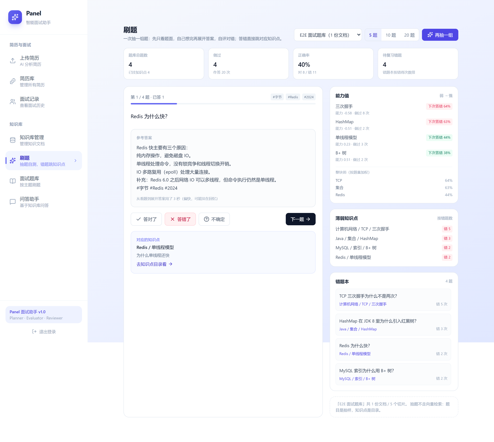

答错时展开「对应的知识点」卡片：树路径 + 一句话说明 + `去知识点目录看` 深链
（`/kb/:id/catalog?node=<id>`，进去就选中该节点）。
这一步是整条链路的目的地——**错了要知道错在哪一层**。

## 7. 能力值：把"面试弱、刷题还行"这种判断变成数字

右侧「能力值」面板，一个知识点一个数：

- 口径是简化 Elo/IRT：`P(答对) = 1/(1+exp(-(θ-b)))`，答完 `θ += 权重 × K × (实际 - 预期)`；
- 做得越多单次冲击越小（`K` 随次数衰减），一两题翻不了盘；
- 遗忘：30 天不练向 0 回落，但最多回落 40%，不抹平已证明的强项；
- 面试信号权重 ×2（高压真实场景，信号更硬）；
- 对外只暴露一个可解释数字：`下次答错 64%`（抽到中等难度题的答错概率）；
- 父节点是按题量加权的子节点平均，所以能说"**TCP 这一整块弱**"，不是只有叶子弱。

## 8. 面试记录也是知识点信号

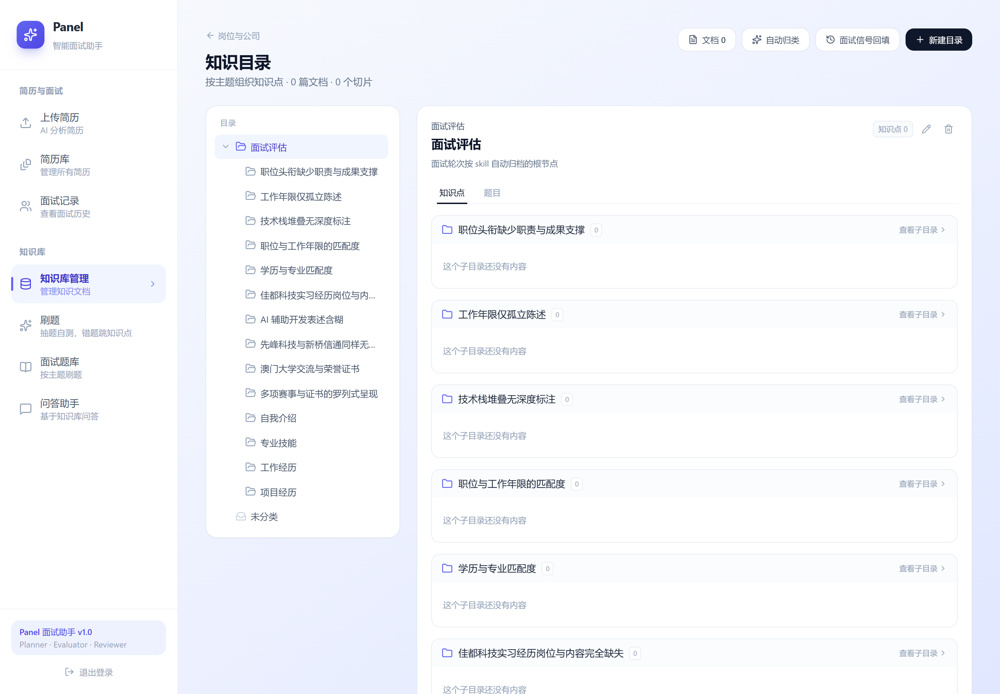

面试记录里每轮都有一个 `skill`（如「自我介绍」「技术栈堆叠无深度标注」）和得分。
回填时按**名字对齐**到知识点（归一化后完全相同 → 命中；互相包含取最长 → 命中；都不行 → 不挂），
得分折算观测：`≥70 算对、40~69 半对、<40 算错`，权重 ×2。

刻意"不猜"：不做模糊匹配、不调模型。目录是产品结构，**错挂比不挂更糟**——
答错时知识点会指到错的地方，学员会以为系统在胡说。匹配不上的会列出来，要建节点必须显式勾选。

回填有台账（`turn_id` 唯一），所以可以反复点「面试信号回填」不会重复计分，也能回答
"我这个知识点为什么是 −2.58"。

## 9. 完成度

| 模块 | 完成度 | 说明 |
|---|---|---|
| 建库/分类/可见性 | 95% | 三种库类型 + PUBLIC/INTERNAL 全链路闸门，直连 id 也 403 |
| 文档上传与解析 | 85% | md/txt/html/pdf/docx；hash 去重、20MB/500 份上限、状态机、重试、重索引 |
| 题目抽取 | 65% | 只认"编号 / Q: / 问："式 md；真实八股文档的选项、图片、表格、`答：`分段还薄 |
| 知识目录 | 85% | 树 CRUD、移动、继承目录、条目分页、挂载/摘除 |
| 自动归类 | 80% | LLM 优先 + 关键词兜底 + 0.72 阈值 + 按文档重跑 + 人工锁定；缺"全库批量按文档跑" |
| 覆盖率看板 | 90% | 缺口队列、逐条/批量确认、按文档一键归类 |
| 刷题闭环 | 90% | 抽题/展开/自评/统计/错题本/思考秒数；缺"续做中断的这组题"的显式入口 |
| 能力值 | 80% | Elo + 衰减 + 树聚合 + 接管抽题 + 面试回填；缺冷启动先验、缺"按能力选难度" |
| 知识点联动 | 45% | 答错跳转已闭环；**相关知识点只有 CRUD，没有生成** |
| 权限 | 90% | 角色 + 权限点双层；面试归属（`resume` 无 `user_id`）仍是缺口 |
| 测试 | 70% | 后端 87 例全绿（抽样/权重/能力值/匹配器）；前端 0 例、无 e2e |
| 检索问答（RAG） | —— | 按需求**暂缓**，不在本模块关键路径上 |

## 10. 还差什么（按优先级）

**P0 · 真实文档的题目抽取**：现在只吃"编号式 md"。真实八股资料大量是
`1. 题目` / `答案：...` / `A. B. C. D.` 选项 / 表格 / 图片题。解析率上不去，
覆盖率就上不去，整条链路还是空的。这是唯一会"卡住产品价值"的缺口。

**P0 · 两棵目录树没有统一**：面试题库和技术知识库各有一棵 `kb_category` 树，
可以一键继承（幂等复制），但之后**各自维护**——改了一边不同步。
彻底解法是单树多视图，或节点带 `shared_key` 共用一张表。

**P1 · 相关知识点生成**：答错时只给"对应的一个知识点"。真正有价值的是
"PREREQUISITE 前置 → 你可能是基础没打牢"，关系表已经有了，缺的是生成候选 + 人工确认。

**P1 · 面试记录的归属**：`interview_session → resume`，而 `resume` 没有 `user_id`，
所以回填必须显式指定 userId。多候选人场景会把评分记到错的账上。

**P1 · 能力值冷启动**：没做过的知识点不在能力值表里，抽题时只能给基线权重。
可以用"该节点题目难度中位数"作为先验补出来。

**P2 · 难度自适应**：现在抽题只按"弱不弱"，不看"该抽多难的"。
θ 高的节点应该抽难一点的题才有区分度。

**P2 · 前端自动化测试**：现在前端靠人点。刷题这种状态机（抽题→展开→自评→下一题→结束）
最适合 e2e，值得补一层。

**P3 · RAG/问答**：按需求暂缓。

## 11. 一句话总结现状

**底板（建库/上传/解析/目录/归类/覆盖率）能跑通并被验证，刷题闭环已经可用；
真正的短板在最上游——真实文档的题目抽取质量，和两棵树的统一。**
把这两件做完，覆盖率能稳定在 90% 以上，答错跳知识点才真正成立。
