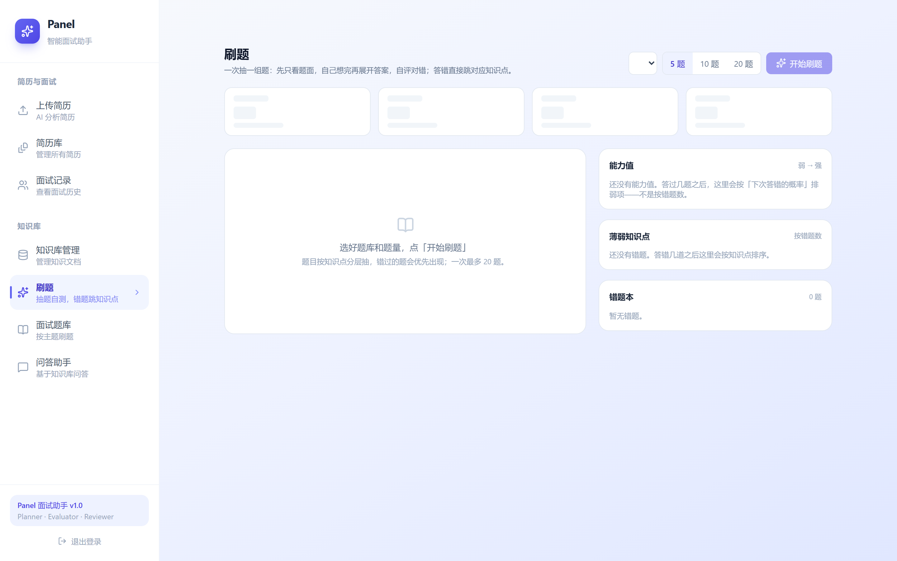
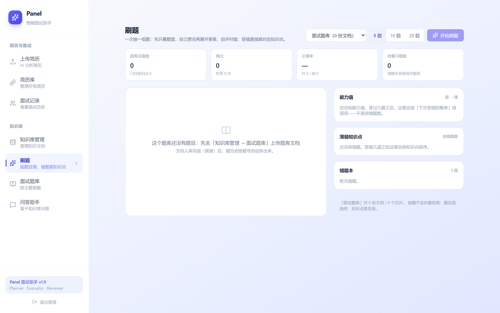
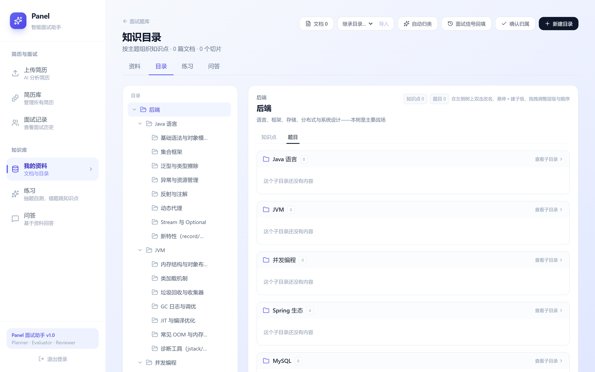
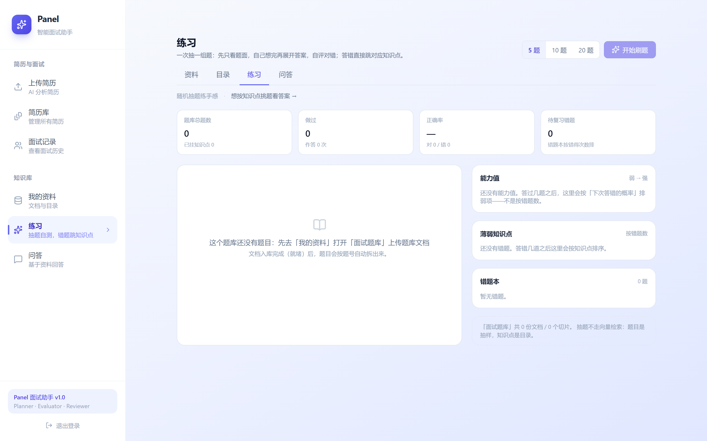

# 知识库体验改造方案（人视角）

> 2026-11-12。起因：自造一份 8 题的文档走完整链路，发现"功能齐全"和"人能用"之间还隔着一层。
> 本文只谈**界面与数据契约**，不动底层能力（解析、归类、抽题算法都已经跑通）。

## 0. 三条实证

走查里最刺眼的三处，都不是功能缺失，而是**系统在跟人撒谎**：

| 人会看到的 | 事实 | 性质 |
|---|---|---|
| 点「自动归类」后提示「已归类 **12** 条」，而库里只有 **8** 道题 | `llmApplied` 累加的是模型批次结果，不是落库条目 | 报告骗人 |
| 进刷题页，统计卡先显示 `0 / 0 / 0 / 0`、按钮灰着，一秒后才变真值 | `stats` 默认 `null`，渲染处一律 `?? 0` | 加载中伪装成空 |
| 0 次作答时「正确率」显示 **0%** | `answered == 0` 时不该有百分比 | 假 0 |
| 侧栏「知识库管理 / 刷题 / 面试题库 / 问答助手」四项，其中「面试题库」和「刷题」其实是同一个库的两个页面 | `/kb/questions` 选库刷题、`/kb/quiz` 抽题刷题，数据同一份 | 一个东西四个名字 |

前三条是同一类错误：**拿内部状态直接当用户可见状态**。第四条是信息架构没按"用户要做的事"分层。

## 1. 六条硬规则

评审时逐条对照，任何一条不满足就不算做完。

1. **屏幕上不出现系统内部名词**：切片、置信度、embedding、K2、`llmApplied`、`chunkSize`。要出现就用人的词：资料、目录、知识点、题目。
2. **同一屏的数字必须能互相印证**：`做过 ≤ 题库总题数`、`对 + 错 + 不确定 = 作答`、`已挂知识点 ≤ 总题数`。任一条不成立就是 bug，不是"边角情况"。
3. **数据没到不渲染 0**：三态显式化 `loading | empty | ready`。`loading` 出骨架，`empty` 出引导，只有 `ready` 才出数字。禁止 `?? 0`。
4. **一个对象只有一个入口**：题库只能从"库"进去，不再有第二个侧栏项指同一份数据。
5. **下一步必须在当前屏可点**：不能让用户回上级菜单去记路。空态要给按钮，不是给"请前往…"。
6. **破坏性操作说清留什么**：删库/删文档要写明"删掉 X，保留 Y"（现有「删结构不删资料」的语义要写进确认框）。

## 2. 方案一：归类报告说人话

### 现状
`POST /kb/{id}/catalog/classify` 返回 `{llmApplied, ruleApplied, skipped, mode, cleared}`，页面拼一句「已归类 N 条」。

### 判断
这个接口是**给人看的结果报告**，不是监控指标。人只问两句：这次挂上几条？没挂上的去哪了？

### 改法
DTO 换成面向结果，且数字用**前后差集**算，天然不会重复计数：

```java
public record ClassifyReport(
        int total,        // 这份库/文档里参与归类的条目数
        int assigned,     // 本次新增或改挂的
        int alreadyPinned,// 本来已确认，跳过
        int pending,      // 挂上了但没确认（进"待确认"）
        int failed,       // 没挂上（进"未分类"）
        String mode,      // LLM / RULE
        List<String> notes // 例如"模型不可用，本次用规则匹配"
) {}
```

实现要点：进入前对 `kb_item_category` 拍一次 `itemId -> categoryId` 快照，结束后再拍一次，`assigned` = 差集大小。`pending` = 结果里 `locked=false` 的数量。

页面文案（三段式，不是一句数）：

```
这次挂上 8 条 · 2 条待确认 · 0 条落在未分类
[看看待确认]  [看看未分类]
```

### 验收
- 同一份文档连点两次「自动归类」：第二次必须是「这次挂上 0 条 · 8 条已确认」；
- 8 题的文档报 `assigned = 8`，永远不可能出现 12。

## 3. 方案二：首屏三态

### 现状
`const [stats] = useState(null)` → 渲染 `stats?.totalQuestions ?? 0`。加载 300ms 内屏幕上是"空题库"，慢网下是几秒。

### 判断
"还没有数据"和"数据就是 0"是两件事。前者该说"我在读"，后者该说"这里确实空，你这样开始"。

### 改法
用一个 `state` 串起来，别在每个字段上判空：

```ts
type Loadable<T> = { phase: 'loading' } | { phase: 'error'; message: string } | { phase: 'ready'; data: T }
```

三态各自的界面：

| phase | 统计卡 | 主按钮 | 说明文字 |
|---|---|---|---|
| loading | 四条灰色骨架条（**不出现 0**） | 置灰「正在读取题库…」 | 隐藏 |
| empty（`totalQuestions === 0`） | 不出四张卡，出一张引导卡 | 「上传题库文档」→ `/kb/1` | 「题库还没有题目，上传一份 md，按 `1. 问题？` 分行写」 |
| ready | 正常数字 | 「开始刷题」 | 现有文案 |

附带两条同源修正：
- `answered === 0` 时正确率显示 `—`，不显示 `0%`（对 0 / 错 0 保留，那是事实）；
- 所有 `?? 0` 换成 `undefined` 语义驱动渲染，grep `?? 0` 应只剩"确实是可选项"的地方。

### 验收
DevTools 网络限速 Slow 3G，进刷题页：全程不出现任何 `0`，只出现骨架；题库真为空时出引导卡且按钮直接可点。

## 4. 方案三：信息架构按"人要做的事"分层

### 现状
```
侧栏 · 知识库
├─ 知识库管理  /kb            ← 库列表
├─ 刷题        /kb/quiz       ← 抽题（内部再选库）
├─ 面试题库    /kb/questions  ← 按主题挑题（内部再选库）
└─ 问答助手    /kb/chat       ← 问答（内部再选库）
```
四个入口里，后三个都是"选一个库然后做一件事"，而且第三次选库的交互一模一样。用户要先理解"库 / 题目 / 知识点"三层模型，才知道点哪。

### 判断
侧栏该放**用户要做的事**，不是系统的模块。人只有三件事：**我有哪些资料**、**我练一下**、**我问它**。

### 改法

第一层，侧栏收敛成三项（`AppLayout.tsx` 的 `NAV_GROUPS`）：

```ts
{ id: 'knowledge', title: '知识库', items: [
  { path: '/kb',       label: '我的资料', description: '文档与目录', icon: Database },
  { path: '/kb/quiz',  label: '练习',     description: '抽题自测，错题跳知识点', icon: Sparkles },
  { path: '/kb/chat',  label: '问答',     description: '基于资料回答', icon: MessageSquare }
]}
```
删掉 `面试题库` 这一项——它就是 `kb_id=1` 的那个库，不该独立成导航。

第二层，进入某个库后，同一屏四个页签（同一份数据的四个视角，不用回侧栏）：

```
面试题库  8 份文档 · 24 个知识点
[ 资料 ] [ 目录 ] [ 练习 ] [ 问答 ]
```

| 页签 | 内容 | 现有页面 |
|---|---|---|
| 资料 | 文档列表、上传、状态 | `KnowledgeBaseDetailPage` 的 `documents` |
| 目录 | 知识目录树 + 条目 + 待确认 | `/kb/:id/catalog` |
| 练习 | 这个库的刷题（题库库才有） | `/kb/quiz?kbId=:id` 内嵌 |
| 问答 | 限定这个库的问答 | `/kb/chat?kbId=:id` 内嵌 |

`/kb/questions`（按主题挑题那页）合并进「练习」页签的"按知识点挑题"子模式，路由保留做 301 式重定向：

```
/kb/questions        → /kb/1?tab=practice
/kb/:id/catalog      → /kb/:id?tab=catalog
/kb/quiz?kbId=:id    → /kb/:id?tab=practice
/kb/chat?kbId=:id    → /kb/:id?tab=chat
```

术语统一（一次性改干净，别再混）：**资料**（文档+切片）、**目录/知识点**、**题目**、**条目**（目录里的东西，用徽标区分是题目还是资料片段）。

### 验收
- 从侧栏到"开始刷某道题"的点击数：改造前 3 次（刷题 → 选库 → 开始），改造后 2 次（练习 → 开始），且题库只有一个时不出现选择器；
- 老链接全部可访问（贴 4 条重定向后的 URL 手工点一遍）；
- 侧栏高亮：在 `/kb/1?tab=catalog` 时高亮「我的资料」，不是没有任何项高亮。

## 5. 落地状态

| 方案 | 状态 | 落点 |
|---|---|---|
| 一 · 归类报告说人话 | **已上线** | `KbClassifyResult{total, assigned, alreadyPinned, pending, failed, mode, cleared, summary}`；数字取自"跑前跑后快照差集"；`KbCatalogPage` / `KbQuizPage` 直接显示后端拼好的 `summary` |
| 二 · 首屏三态 | **已上线** | `statsPhase: 'loading' \| 'ready'` + `StatCardSkeleton`；`answered === 0` 时正确率显示 `—`；空题库出引导文案、按钮置灰 |
| 三 · 信息架构 | **已上线** | 侧栏收到三项；新增 `components/KbTabs.tsx`，库内四个视角一条页签；新增 `/kb/:id/quiz`、`/kb/:id/chat` 两条路由 |

### 上线后实测

```
上传一份 8 题的 md：
  上传时 ingest 自动归类 → 挂了 8 道题
  手动点「自动归类」      → 这次挂上 4 条 · 12 条待确认 · 0 条落在未分类
  再点一次（幂等）        → 这次挂上 0 条 · 12 条待确认 · 0 条落在未分类
库里实际               → CHUNK 4 + QUESTION 8 = 12 条，和屏幕上说的 12 一致
```

对比改造前同一场景：`{llmApplied: 12}`——库里 8 条，报告说 12。

慢网（CDP 限速 1.5s）下首屏不再出现任何 0：



就绪后空题库的样子（正确率是 `—` 不是 `0%`，按钮置灰并说清下一步）：



### 实现时踩到的坑（值得记）

第一次改成差集后，报告说"挂上 4 条 · 4 条待确认"，而库里明明有 12 条。原因：
`findAssignedItemIds` 与 `snapshotLocked` 都标了 `@Transactional(readOnly = true)`，
**只读事务不 flush**，刚 `persist` 的挂载在同一个事务里读不到，快照少算了一半。
修法：拍"跑之后"的快照前显式 `links.flushPending()`。

> 这类 bug 的特点是：功能完全正常（数据都写对了），只有**报告**是错的。
> 所以它躲过了所有功能性测试，只有"拿屏幕上的数字去对库里的数字"才能发现。

## 6. 方案三的实现记录

计划里写的是 `?tab=`，落成了**路径段**，理由：库内四个视角本来就是四个不同页面（资料页和练习页组件完全不同），
做成 query 会在同一路由里手写四套渲染分支；路径段还能直接代码分割、能贴给同事。

| 视角 | 路径 | 组件 |
|---|---|---|
| 资料 | `/kb/:id` | `KnowledgeBaseDetailPage`（内含 文档 / 检索测试 二级页签） |
| 目录 | `/kb/:id/catalog` | `KbCatalogPage` |
| 练习 | `/kb/:id/quiz` | `KbQuizPage` |
| 问答 | `/kb/:id/chat` | `KbChatPage` |
| 挑题（按知识点看答案） | `/kb/questions?kbId=` | `KbQuestionBankPage`，从练习页的一句链接进，不再占导航位 |

侧栏从四项收到三项：**我的资料 / 练习 / 问答**，`面试题库` 从导航里消失——它只是 `kb_id=1` 那个库，不该跟"练习"平级。







实测（Playwright 逐条访问）：

```
侧栏      我的资料 · 练习 · 问答                        （三项，无「面试题库」）
/kb/1           → 页签 资料|目录|练习|问答，资料高亮，侧栏「我的资料」亮
/kb/1/catalog   → 页签同上，目录高亮
/kb/1/quiz      → 页签同上，练习高亮；库选择器自动隐藏（路径已经指定库）
/kb/1/chat      → 页签同上，问答高亮
老链接 /kb/questions?kbId=1、/kb/quiz?kbId=1、/kb/chat?kbId=1 全部仍可用
pageerror 0
```

顺带一起处理的：

- 进库页面后侧栏不再"全灭"——`isActive` 补了 `/kb/\d+` 且不属于 quiz/chat 的判定；
- 文案里残留的旧导航名统一改掉（「知识库管理」→「我的资料」、「问答助手」→「问答」），否则人按字面去点会找不到；
- 「知识库目录」按钮从资料页移除（页签里已经有了），资料页只留「上传文档」。

## 7. 明确不做的

- 不动解析、分类、抽题算法（都验证过）；
- 不做"知识图谱可视化"（用户明确不要实体级图）；
- 不给每个页面加引导弹窗/新手教程——空态和按钮本身就是引导，弹窗只是噪音。


