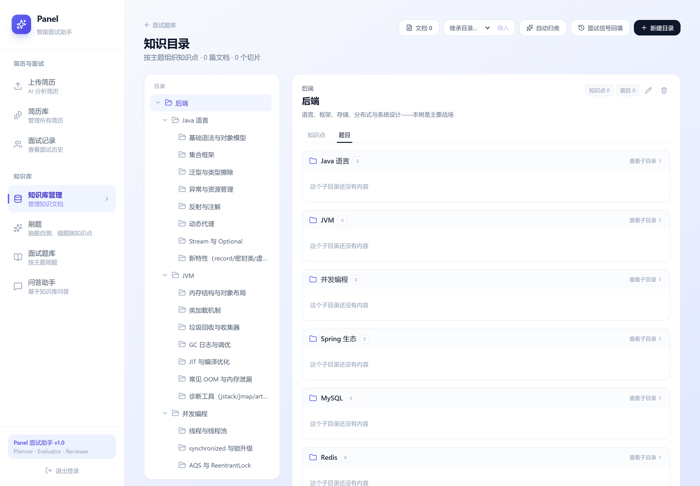
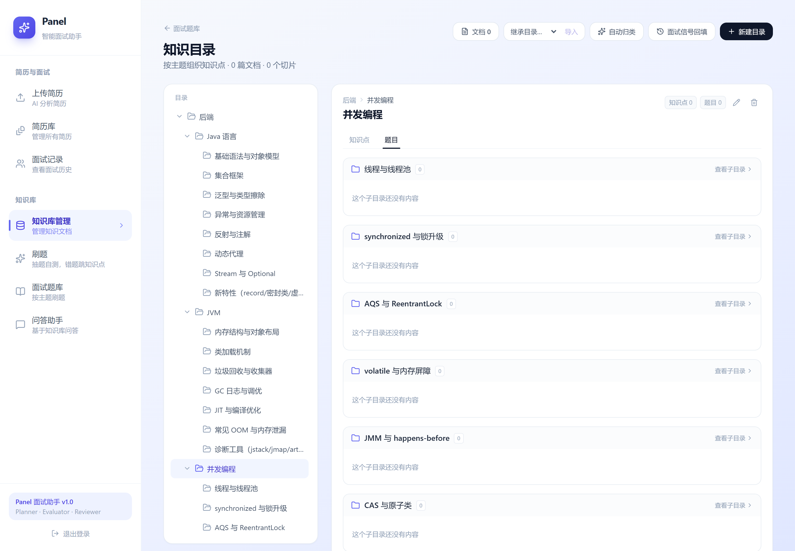

# 知识树 v1（全栈 + Agent，资料偏后端/Agent）

> **状态：已同步（2026-11-12）。** kb1 题库 214 个节点，kb2 技术知识继承同一棵树 214 个节点。
> 机读版本：`tmp/kb-tree/tree.json`；同步脚本：`tmp/kb-tree/sync.js`（幂等，默认 dry-run）。

## 0. 执行结果

```
DELETE  kb1 原有 12 个测试节点（0 题 0 文档，无数据丢失）        → 12/12 成功
node sync.js --kb=1                                            → 新建 214 个、跳过 0 个
node sync.js --kb=1（复跑验证幂等）                              → 新建 0 个、跳过 214 个
POST /kb/2/catalog/import?sourceKbId=1                          → {imported:214, skipped:0, total:214}
node sync.js --kb=2（复跑验证幂等）                              → 新建 0 个、跳过 214 个

kb_category 校验：
  kb1  214 节点 / 214 条不同 path_key / depth 1~3 / 179 个叶子
  kb2  214 节点 / 214 条不同 path_key / depth 1~3 / 179 个叶子
  五个一级领域：后端(11 主题) / Agent 与 LLM(7) / 前端与全栈(5) / 计算机基础(4) / 工程与运维(3)
```





## 1. 设计约束（受实现限制，不是口味选择）

- **最多 3 级**（`KbCategory.MAX_DEPTH=3`），所以 L1 = 领域、L2 = 主题、L3 = 考点。
- **两棵树用同一套 pathKey**：先建在题库库（`question-bank`），再用「继承目录」复制到技术知识库（`tech-knowledge`）。
  这样"答错跳知识点"落在题库树的节点上，技术文档切片按同一条路径归档，两边能对上号。
- **空节点是合法的**：前端/工程这两块资料薄，先占位，看板上会显示"这个节点下 0 份资料"，就是补资料待办。
- **面试软技能不在本树**：自我介绍/项目深挖/行为面已经在 `job-knowledge`（岗位与公司）库的「面试评估」树下，
  那边是面试评分口径，不要合并进来。

## 2. 规模

| 层 | 数量 |
|---|---|
| L1 领域 | 5 |
| L2 主题 | 30 |
| L3 考点 | 179 |
| 合计节点 | 214 |
| 叶子数（≈ 归类候选数） | 179 |

| 领域 | L2 主题数 | 叶子数 |
|---|---|---|
| 后端 | 11 | 84 |
| Agent 与 LLM | 7 | 43 |
| 前端与全栈 | 5 | 23 |
| 计算机基础 | 4 | 19 |
| 工程与运维 | 3 | 10 |

> 叶子数直接决定自动归类的难度：候选越多，模型越容易选错。179 个叶子属于"偏多但可控"，
> 前提是每题都带 `#标签` 或题干里出现主题词。等真实文档跑一轮，如果归类准确率低于 80%，
> 优先做法是**把 L3 收拢到 L2**（题库库也按 L2 挂），而不是继续加节点。

## 3. 完整树

```
后端
  ├─ Java 语言  · 8
  │  ├─ 基础语法与对象模型
  │  ├─ 集合框架
  │  ├─ 泛型与类型擦除
  │  ├─ 异常与资源管理
  │  ├─ 反射与注解
  │  ├─ 动态代理
  │  ├─ Stream 与 Optional
  │  └─ 新特性（record/密封类/虚拟线程）
  ├─ JVM  · 7
  │  ├─ 内存结构与对象布局
  │  ├─ 类加载机制
  │  ├─ 垃圾回收与收集器
  │  ├─ GC 日志与调优
  │  ├─ JIT 与编译优化
  │  ├─ 常见 OOM 与内存泄漏
  │  └─ 诊断工具（jstack/jmap/arthas）
  ├─ 并发编程  · 10
  │  ├─ 线程与线程池
  │  ├─ synchronized 与锁升级
  │  ├─ AQS 与 ReentrantLock
  │  ├─ volatile 与内存屏障
  │  ├─ JMM 与 happens-before
  │  ├─ CAS 与原子类
  │  ├─ ConcurrentHashMap
  │  ├─ ThreadLocal
  │  ├─ 阻塞队列与并发容器
  │  └─ CompletableFuture 异步编排
  ├─ Spring 生态  · 8
  │  ├─ IoC 与 Bean 生命周期
  │  ├─ AOP 与代理
  │  ├─ 事务传播与失效场景
  │  ├─ Spring MVC 参数绑定
  │  ├─ Spring Boot 自动装配
  │  ├─ 过滤器与拦截器
  │  ├─ 全局异常与统一返回
  │  └─ 循环依赖
  ├─ MySQL  · 8
  │  ├─ 索引与 B+ 树
  │  ├─ 执行计划与索引失效
  │  ├─ 事务与隔离级别
  │  ├─ MVCC 与锁
  │  ├─ 慢查询与优化
  │  ├─ 分库分表
  │  ├─ 主从复制与延迟
  │  └─ 表设计与范式
  ├─ Redis  · 8
  │  ├─ 数据结构与底层编码
  │  ├─ 持久化（RDB/AOF）
  │  ├─ 过期策略与内存淘汰
  │  ├─ 缓存穿透击穿雪崩
  │  ├─ 分布式锁
  │  ├─ 主从哨兵与集群
  │  ├─ 热点 Key 与大 Key
  │  └─ 缓存一致性
  ├─ 消息队列  · 7
  │  ├─ Kafka 架构与存储
  │  ├─ 分区与消费组
  │  ├─ 顺序性与幂等
  │  ├─ 消息可靠性（不丢不重）
  │  ├─ 重试与死信队列
  │  ├─ 积压治理
  │  └─ MQ 选型对比
  ├─ 分布式与微服务  · 8
  │  ├─ CAP 与一致性模型
  │  ├─ 分布式事务
  │  ├─ 服务注册与发现
  │  ├─ 限流熔断降级
  │  ├─ 链路追踪
  │  ├─ 配置中心
  │  ├─ 幂等设计
  │  └─ 分布式 ID
  ├─ 系统设计  · 8
  │  ├─ 秒杀与库存扣减
  │  ├─ 短链系统
  │  ├─ Feed 流与时间线
  │  ├─ 排行榜
  │  ├─ 订单与支付对账
  │  ├─ 长连接与消息推送
  │  ├─ 多租户设计
  │  └─ 容量评估与压测
  ├─ 网络与协议  · 7
  │  ├─ TCP 三次握手与四次挥手
  │  ├─ TCP 重传与拥塞控制
  │  ├─ HTTP/1.1 与 HTTP/2
  │  ├─ HTTPS 与 TLS 握手
  │  ├─ DNS 与 CDN
  │  ├─ WebSocket 与 SSE
  │  └─ gRPC 与 Protobuf
  └─ 容器与云原生  · 5
     ├─ Docker 镜像与分层
     ├─ K8s 核心对象
     ├─ 发布与滚动更新
     ├─ 资源限制与调度
     └─ 日志监控接入
Agent 与 LLM
  ├─ LLM 基础  · 6
  │  ├─ Transformer 与注意力
  │  ├─ Tokenizer 与上下文窗口
  │  ├─ 采样与生成参数
  │  ├─ 推理成本与延迟
  │  ├─ 幻觉与能力边界
  │  └─ 模型选型
  ├─ Prompt 工程  · 6
  │  ├─ 角色与指令设计
  │  ├─ Few-shot 与示例选择
  │  ├─ 结构化输出
  │  ├─ 思维链与自洽
  │  ├─ 提示注入与防护
  │  └─ 长上下文与摘要压缩
  ├─ RAG 检索增强  · 7
  │  ├─ 文档切分策略
  │  ├─ Embedding 与向量库
  │  ├─ 混合检索（关键词+向量）
  │  ├─ 重排 Rerank
  │  ├─ 查询改写与多路召回
  │  ├─ 增量索引与更新
  │  └─ RAG 评测（召回/命中）
  ├─ 工具调用  · 6
  │  ├─ Function Calling 协议
  │  ├─ 工具定义与参数校验
  │  ├─ 多工具编排
  │  ├─ 结果回填与错误重试
  │  ├─ 权限与危险操作拦截
  │  └─ MCP 协议
  ├─ Agent 架构与编排  · 7
  │  ├─ ReAct 与 Plan-Execute
  │  ├─ 多 Agent 协作
  │  ├─ 状态机与工作流编排
  │  ├─ 记忆机制（短期/长期/摘要）
  │  ├─ 反思与自我修正
  │  ├─ 循环与终止条件
  │  └─ 上下文预算管理
  ├─ Agent 工程化  · 6
  │  ├─ 可观测性与 Trace
  │  ├─ 评测集与回归
  │  ├─ 成本与延迟优化
  │  ├─ 缓存与幂等
  │  ├─ 失败降级与人工兜底
  │  └─ 安全（注入/越权/数据外泄）
  └─ 应用落地  · 5
     ├─ 面试助手产品设计
     ├─ 简历解析与结构化
     ├─ 评分与 rubric 设计
     ├─ 流式输出与前端交互
     └─ 多租户与配额
前端与全栈
  ├─ JavaScript 与 TypeScript  · 5
  │  ├─ 作用域与闭包
  │  ├─ 原型与继承
  │  ├─ 事件循环与微任务
  │  ├─ Promise 与 async/await
  │  └─ TypeScript 类型系统
  ├─ React  · 5
  │  ├─ 组件与状态
  │  ├─ Hooks 与依赖
  │  ├─ 渲染与 Diff
  │  ├─ 性能优化
  │  └─ 状态管理选型
  ├─ 浏览器与安全  · 5
  │  ├─ 渲染流程与重排重绘
  │  ├─ HTTP 缓存
  │  ├─ 同源策略与 CORS
  │  ├─ XSS 与 CSRF
  │  └─ 性能指标（LCP/INP/CLS）
  ├─ 工程化  · 4
  │  ├─ 构建工具（Vite/Webpack）
  │  ├─ 依赖治理
  │  ├─ 测试与 e2e
  │  └─ 监控与埋点
  └─ Node 与 BFF  · 4
     ├─ Node 事件循环
     ├─ 分层与鉴权
     ├─ 接口聚合与降级
     └─ 实时通信（SSE/WebSocket）
计算机基础
  ├─ 数据结构与算法  · 7
  │  ├─ 数组链表与队列
  │  ├─ 哈希表
  │  ├─ 树与堆
  │  ├─ 图与遍历
  │  ├─ 排序与二分
  │  ├─ 动态规划
  │  └─ 复杂度分析
  ├─ 操作系统  · 4
  │  ├─ 进程与线程
  │  ├─ 内存与虚拟内存
  │  ├─ IO 模型与零拷贝
  │  └─ 调度与上下文切换
  ├─ 网络基础  · 4
  │  ├─ 分层模型
  │  ├─ 拥塞控制
  │  ├─ 粘包与拆包
  │  └─ 长连接与心跳
  └─ 数据库原理  · 4
     ├─ 索引结构对比（B树/B+树/LSM）
     ├─ 事务与日志（redo/undo）
     ├─ 查询优化器
     └─ 范式与建模
工程与运维
  ├─ Git 与协作  · 3
  │  ├─ 分支模型
  │  ├─ rebase 与 merge
  │  └─ 回滚与冲突
  ├─ CI/CD 与发布  · 3
  │  ├─ 流水线设计
  │  ├─ 镜像与发布
  │  └─ 灰度与回滚
  └─ 可观测性与排查  · 4
     ├─ 日志规范
     ├─ 指标与告警
     ├─ 链路追踪
     └─ 线上故障排查
```

## 4. 紧凑视图（方便逐条 review）

**后端**
- Java 语言（8）：基础语法与对象模型、集合框架、泛型与类型擦除、异常与资源管理、反射与注解、动态代理、Stream 与 Optional、新特性（record/密封类/虚拟线程）
- JVM（7）：内存结构与对象布局、类加载机制、垃圾回收与收集器、GC 日志与调优、JIT 与编译优化、常见 OOM 与内存泄漏、诊断工具（jstack/jmap/arthas）
- 并发编程（10）：线程与线程池、synchronized 与锁升级、AQS 与 ReentrantLock、volatile 与内存屏障、JMM 与 happens-before、CAS 与原子类、ConcurrentHashMap、ThreadLocal、阻塞队列与并发容器、CompletableFuture 异步编排
- Spring 生态（8）：IoC 与 Bean 生命周期、AOP 与代理、事务传播与失效场景、Spring MVC 参数绑定、Spring Boot 自动装配、过滤器与拦截器、全局异常与统一返回、循环依赖
- MySQL（8）：索引与 B+ 树、执行计划与索引失效、事务与隔离级别、MVCC 与锁、慢查询与优化、分库分表、主从复制与延迟、表设计与范式
- Redis（8）：数据结构与底层编码、持久化（RDB/AOF）、过期策略与内存淘汰、缓存穿透击穿雪崩、分布式锁、主从哨兵与集群、热点 Key 与大 Key、缓存一致性
- 消息队列（7）：Kafka 架构与存储、分区与消费组、顺序性与幂等、消息可靠性（不丢不重）、重试与死信队列、积压治理、MQ 选型对比
- 分布式与微服务（8）：CAP 与一致性模型、分布式事务、服务注册与发现、限流熔断降级、链路追踪、配置中心、幂等设计、分布式 ID
- 系统设计（8）：秒杀与库存扣减、短链系统、Feed 流与时间线、排行榜、订单与支付对账、长连接与消息推送、多租户设计、容量评估与压测
- 网络与协议（7）：TCP 三次握手与四次挥手、TCP 重传与拥塞控制、HTTP/1.1 与 HTTP/2、HTTPS 与 TLS 握手、DNS 与 CDN、WebSocket 与 SSE、gRPC 与 Protobuf
- 容器与云原生（5）：Docker 镜像与分层、K8s 核心对象、发布与滚动更新、资源限制与调度、日志监控接入

**Agent 与 LLM**
- LLM 基础（6）：Transformer 与注意力、Tokenizer 与上下文窗口、采样与生成参数、推理成本与延迟、幻觉与能力边界、模型选型
- Prompt 工程（6）：角色与指令设计、Few-shot 与示例选择、结构化输出、思维链与自洽、提示注入与防护、长上下文与摘要压缩
- RAG 检索增强（7）：文档切分策略、Embedding 与向量库、混合检索（关键词+向量）、重排 Rerank、查询改写与多路召回、增量索引与更新、RAG 评测（召回/命中）
- 工具调用（6）：Function Calling 协议、工具定义与参数校验、多工具编排、结果回填与错误重试、权限与危险操作拦截、MCP 协议
- Agent 架构与编排（7）：ReAct 与 Plan-Execute、多 Agent 协作、状态机与工作流编排、记忆机制（短期/长期/摘要）、反思与自我修正、循环与终止条件、上下文预算管理
- Agent 工程化（6）：可观测性与 Trace、评测集与回归、成本与延迟优化、缓存与幂等、失败降级与人工兜底、安全（注入/越权/数据外泄）
- 应用落地（5）：面试助手产品设计、简历解析与结构化、评分与 rubric 设计、流式输出与前端交互、多租户与配额

**前端与全栈**
- JavaScript 与 TypeScript（5）：作用域与闭包、原型与继承、事件循环与微任务、Promise 与 async/await、TypeScript 类型系统
- React（5）：组件与状态、Hooks 与依赖、渲染与 Diff、性能优化、状态管理选型
- 浏览器与安全（5）：渲染流程与重排重绘、HTTP 缓存、同源策略与 CORS、XSS 与 CSRF、性能指标（LCP/INP/CLS）
- 工程化（4）：构建工具（Vite/Webpack）、依赖治理、测试与 e2e、监控与埋点
- Node 与 BFF（4）：Node 事件循环、分层与鉴权、接口聚合与降级、实时通信（SSE/WebSocket）

**计算机基础**
- 数据结构与算法（7）：数组链表与队列、哈希表、树与堆、图与遍历、排序与二分、动态规划、复杂度分析
- 操作系统（4）：进程与线程、内存与虚拟内存、IO 模型与零拷贝、调度与上下文切换
- 网络基础（4）：分层模型、拥塞控制、粘包与拆包、长连接与心跳
- 数据库原理（4）：索引结构对比（B树/B+树/LSM）、事务与日志（redo/undo）、查询优化器、范式与建模

**工程与运维**
- Git 与协作（3）：分支模型、rebase 与 merge、回滚与冲突
- CI/CD 与发布（3）：流水线设计、镜像与发布、灰度与回滚
- 可观测性与排查（4）：日志规范、指标与告警、链路追踪、线上故障排查


## 5. 与现状的差异（已执行）

| 库 | 同步前 | 现在 |
|---|---|---|
| `question-bank`（kb1，题库） | 12 个测试节点（Java/MySQL/计算机网络/Redis + 3 级），**0 题 0 文档** | 12 个测试节点已删；本树 214 个节点 |
| `tech-knowledge`（kb2，技术知识） | **0 个节点**，3 份文档未归档 | 继承同一棵树 214 个节点；3 份文档的切片**还没归类**（下一步） |
| `job-knowledge`（kb3，岗位与公司） | 15 个节点（面试评估树） | 未动 |
| `e2e-qbank` / `e2e-techdoc` | 联调用的 4 题 / 6 节点 | 未动，测完可删 |

删掉的 12 个节点没挂任何题目或文档（kb1 是 0 题 0 文档），不存在数据丢失。

## 6. 同步方式

```powershell
# 幂等，可随时复跑：已存在的同名同级节点直接跳过
node tmp/kb-tree/sync.js --kb=1 --dry-run   # 只看计划
node tmp/kb-tree/sync.js --kb=1             # 真建（也只补缺失的）
node tmp/kb-tree/sync.js --kb=2             # 技术知识库同样可补
node tmp/kb-tree/sync.js --kb=2 --level=2   # 也可以只补到 L2
```

坑（已修）：`GET /catalog/tree` 返回的是**嵌套树**，不是平表。第一版脚本按平表建索引，
复跑时找不到已存在的子节点，直接撞「同级目录下已有同名节点」——所以脚本现在会先递归摊平。

### 6.1 脚本之外：树也能在页面上直接改

批量建树用脚本，日常微调用页面（`/kb/:id/catalog` 左侧目录树）：双击改名、悬停 `＋` 建子级、
拖拽换层级/调顺序、行内确认删除。接口层面对应：

| 操作 | 接口 | 说明 |
| --- | --- | --- |
| 新建 | `POST /kb/{id}/catalog/categories {parentId,name}` | 父节点自动展开 |
| 改名 | `PATCH /kb/catalog/categories/{id} {name}` | `path_key` 与整棵子树同步改；`description` 传 null 表示不动 |
| 移动/排序 | `POST /kb/catalog/categories/{id}/move {parentId,beforeId}` | `beforeId` 为 null = 放到末尾；同级 `sort_no` 按 10 重排 |
| 删除 | `DELETE /kb/catalog/categories/{id}?cascade=true` | 级联删子树，子树上的题目/切片只摘挂载回到「未分类」 |

改动口径见 [知识库与刷题业务设计 §4.1](知识库与刷题业务设计.md#41-目录树就地改不弹窗直接在树上动)。

## 7. 校验结果

- ✅ 结构校验：无空名、无同级重名、无重复路径、深度均 ≤ 3
- ✅ 落库校验：kb1 / kb2 各 214 节点、214 条不同 `path_key`、179 个叶子
- ✅ 幂等校验：两个库复跑均「新建 0 个、跳过 214 个」

## 8. 已按推荐落地 + 三个仍可调整的口味问题

1. **叶子停在 L3**（考点级，答错跳转最精确）。如果真实文档跑一轮归类准确率低于 80%，
   先做的是**把叶子收拢到 L2**（`node tmp/kb-tree/sync.js --kb=1 --level=2` 只补不删，收拢要手工合并）。
2. **前后端比例**：后端 11 个主题 / Agent 7 个主题 / 前端 5 个主题。
   资料偏后端与 Agent 没问题，但面试会问前端——如果这块打算放弃，把前端压成 2 个主题。
3. **「系统设计」作为独立主题**保留着（场景题有地方挂），但它和 MySQL/Redis/消息队列 有重叠，
   答错时可能本该跳 Redis。观察一轮真实刷题数据后再决定要不要拆。

## 9. 下一步（这次只建了骨架，还没喂内容）

1. **给 kb1 导题**：现在还 0 道题，抽题接口会返回"题库里还没有题目"。真实八股文档先按 md 编号式整理，
   上传后走 `题目抽取` → `自动归类`。
2. **给 kb2 的 3 份文档归类**：`POST /kb/2/catalog/documents/{id}/classify`，看落地在哪些节点。
3. **跑一轮归类准确率**：人工抽查 20 条，低于 80% 就按 §8.1 收拢层级。

## 9. 刻意没放进去的（v1.1 候选）

这些是"该有但现在资料肯定没有"的主题，先不建，避免一次生成一堆空节点淹没看板：

- 后端：设计模式、Netty 与 NIO、Elasticsearch、Zookeeper/Dubbo、API 网关
- 前端：跨端与小程序、微前端、可视化
- Agent：模型微调与蒸馏、多模态、Agent 沙箱执行

如果其中有你已经攒了资料的，说一声我加进 L2。

## 10. 附：树是怎么被程序用到的（为什么结构比名字重要）

- 自动归类把**叶子列表**塞进 prompt 当候选，让模型选 id 或新建路径 → 叶子越多越难选准；
- 抽题按**主知识点分桶**，一个桶一次最多出 2 题 → 主题不能太碎，否则 5 题会散在 5 个不相干的点上；
- 能力值按**树聚合**，父节点 = 子节点按题量加权 → "TCP 这一块弱"这种结论依赖 L2 的语义干净；
- 答错跳转给的是**节点深链** → 跳到哪一级，决定你看到的是"知识点卡片"还是"一堆原文"。
