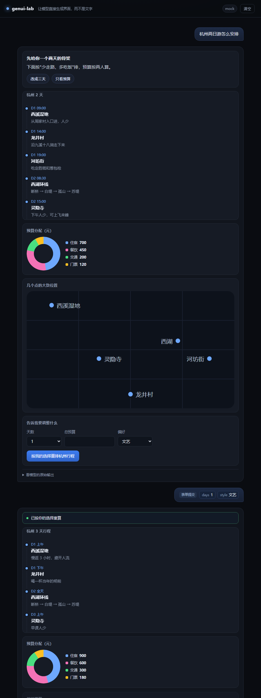
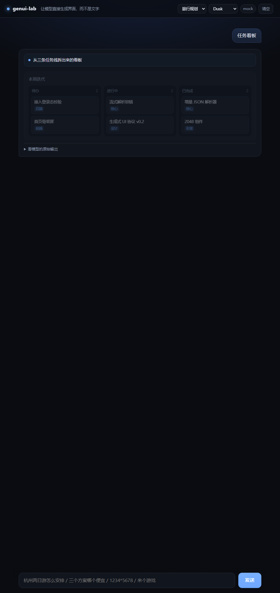
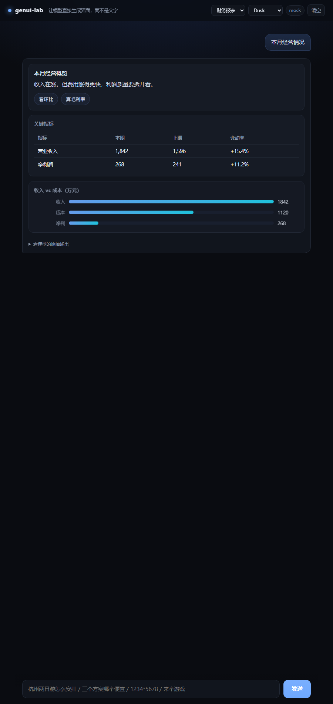
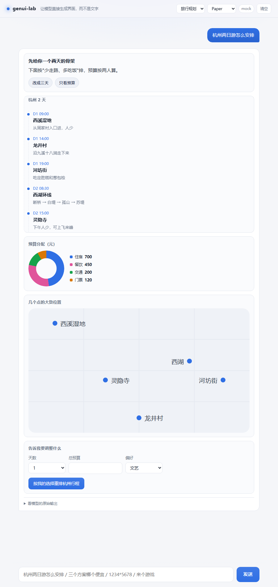
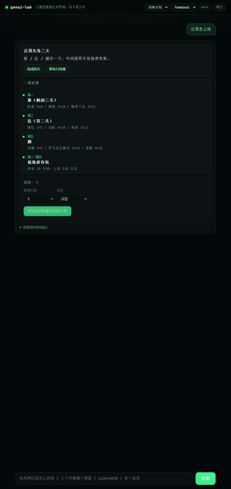

# genui-lab

> 让模型**直接生成界面**，而不是生成文字。

输入一句话，模型返回的不是一段话，而是一个 JSON 数组。前端把它渲染成真实的组件：时间轴、饼图、离线地图、表单、看板、测验、以及一个能玩的 2048。

表单提交、按钮点击、答题、游戏结束后，结构化结果会**回传给模型**，整个界面重排。

零依赖：一个 `server.mjs` + 三个静态文件，不需要 `npm install`。



---

## 30 秒跑起来

```bash
node server.mjs
# 打开 http://127.0.0.1:8787
```

没配 key 也能完整体验——`server.mjs` 里内置了 mock 分支，按关键词返回不同的 block 组合，并模拟逐字流式输出。

接真模型（任何 OpenAI 兼容接口）：

```bash
# PowerShell
$env:API_KEY="sk-xxx"; $env:API_BASE="https://api.deepseek.com/v1"; $env:MODEL="deepseek-chat"; node server.mjs
```

---

## 目录

```
genui-lab/
├── server.mjs          # 静态服务 + /api/chat 流式代理 + 11 种 block 协议 + 3 个场景
├── public/
│   ├── index.html      # 外壳（含场景/主题切换）
│   ├── app.js          # 增量解析 + 11 个渲染器 + 闭环
│   └── styles.css      # 3 套主题，全部 CSS 变量
├── cdp-shot.mjs        # 开发用：CDP 截图（等渲染完成再拍）
└── cdp-flow.mjs        # 开发用：验证表单闭环
```

---

## 一、协议：11 种 block

整个项目的设计全在这张表里。**协议的封闭性，决定了渲染器的可控性**。

| type | 用途 | 可交互 |
|---|---|---|
| `card` | 结论/解释 | ✅ 按钮 |
| `table` | 明细清单 | — |
| `chart` | 对比/占比/趋势 | — |
| `form` | 收集参数 | ✅ 提交 |
| `timeline` | 计划/步骤 | — |
| `calc` | 算术 | — |
| `map` | 地点分布 | — |
| `game` | 可玩 | ✅ 键盘 |
| `note` | 一行状态 | — |
| `kanban` | 看板/任务流 | — |
| `quiz` | 出题/自测 | ✅ 作答 |

三条原则：

1. **封闭集合**。模型不能发明类型。渲染器只有 11 个分支，永远不会渲染出意外的东西。
2. **每个 block 都是可交互句柄**。`card.actions[i].intent`、`form.submit`、`quiz` 的作答，存的都是**一句话**，触发时原样发回模型。
3. **能可视化就不写字**。`card` 只用于总结，数据一律走 table / chart / timeline / map。

---

## 二、三个改造方向

这套东西的价值在于：**协议层不变，其他三层随便换**。

| 方向 | 改哪一层 | 改什么 | 成本 | 效果 |
|---|---|---|---|---|
| ① 加组件 | 组件层 | 一个渲染函数 + 一个 case | 20–40 行 | 能力边界扩大 |
| ② 换场景 | 语义层 | 一段 `rules` 文本 | 10 行 | 变成另一个产品 |
| ③ 换主题 | 视觉层 | `[data-theme]` 一个块 | 30 行 | 换一种人格 |

### ① 加组件：从 9 种到 11 种

新增了两个类型，一个纯展示、一个交互：

```js
// server.mjs —— 协议里加两行
10. {"type":"kanban","title":"可选","columns":[{"name":"待办","cards":[{"title":"事项","tag":"标签"}]}]}
11. {"type":"quiz","title":"可选","question":"题干","options":["A","B","C"],"answer":1,"explain":"答对后的解释"}
```

```js
// app.js —— 加一个 case + 一个纯函数
case 'kanban': return renderKanban(b);
case 'quiz':   return renderQuiz(b);
```

`kanban` 是纯渲染（CSS grid 自动列 + 横向滚动）。真正的看点在于 **`quiz` 是可作答的**：点选项 → 立刻显示对错和解析 → 把「我选了什么、正确答案是什么」回传给模型 → 模型可以接着出下一题。



> **加组件的判断标准**：它能不能产生新的回传信号？只能展示的组件是装饰；能产生结构化输入的组件才是新能力。`kanban` 是装饰，`quiz` 是能力。

### ② 换场景：同一个协议，三种"方言"

架构上把提示词拆成两半：

```
buildSystemPrompt(scenario)
  = 通用规则（11 种 block 定义 + 选择规则 + 风格）
  + SCENARIOS[scenario].rules   ← 只有这一段不同
```

三个场景的 `rules` 差异：

| 场景 | 关键约束 | 典型输出 |
|---|---|---|
| 旅行规划 | 地点→map，行程→timeline，预算→pie，缺参数→form | card+timeline+chart+map+form |
| 财务报表 | **禁用 map/game/timeline/quiz**；数字必须先 table 再 chart；变动 >20% 用 note(warn)；语气克制不用感叹号 | card+table+chart |
| 训练计划 | 一周→timeline，动作组数→table，热量→pie，问诊→quiz | card+timeline+form |



> **换场景的诀窍是"负向约束"比"正向描述"更有效**。写"你是财务专家"没用；写"不要用 map、game、timeline"立刻见效。模型的默认倾向是堆砌所有能用的组件。

### ③ 换主题：不是换颜色，是换人格

全部颜色收进 CSS 变量，一个 `data-theme` 属性切换：

```css
:root            { --bg:#0a0c11; --accent:#6ea8fe; ... }   /* Dusk */
[data-theme="paper"]    { --bg:#f5f6f9; --accent:#2f6fe4; ... }
[data-theme="terminal"] { --bg:#05080a; --accent:#35f08a; ... }
```

三套主题的性格差异来自三个决定，不是色相：

- **Dusk**：深蓝底 + 半透明玻璃 → 默认，适合演示
- **Paper**：近白底 + 蓝主色 + 大圆角 → 像正经 SaaS 产品
- **Terminal**：纯黑 + 荧光绿 + **等宽字体 + 4px 圆角** → 像开发工具




> 真正让 Terminal 像 Terminal 的不是绿色，是 `border-radius: 4px` 和等宽字体。换人格靠的是**形状和字体**，颜色只是最后一步。

---

## 三、三个关键实现

### 1. 增量 JSON 解析（最难的部分）

流式时收到的是半截 JSON：

```
[{"type":"card","title":"先给你
一个两天的骨架","body":"下面按\"少
```

等完整回答再渲染 = 盯空白 3 秒。所以要边收边解析：扫描字符串，用括号深度找到"已闭合的顶层对象"，找到一个渲染一个。

```js
let depth = 0, inStr = false, escNext = false;
for (; j < buf.length; j++) {
  const c = buf[j];
  if (inStr) {                          // 字符串内部：只认转义
    if (escNext) escNext = false;
    else if (c === '\\') escNext = true;
    else if (c === '"') inStr = false;
  } else {
    if (c === '"') inStr = true;        // 进入字符串
    else if (c === '{') depth++;
    else if (c === '}') { depth--; if (depth === 0) break; }
  }
}
```

**字符串 + 转义状态是必须的**。模型会输出 `{"body":"他说\"{\"不是括号"}`，不判断"是否在字符串内"，括号计数立刻错位。

配游标做增量：`const { blocks, next } = takeBlocks(buf, offset)`。

### 2. 流式

服务端只做格式转译：上游 `delta.content` → `data: {"delta":"..."}`。
浏览器端必须手写 `fetch + ReadableStream`（`EventSource` 不支持 POST）。

```js
buf += dec.decode(value, { stream: true });   // stream:true 不能省，中文会被切断
```

### 3. 闭环才是核心

| 触发 | 回传 |
|---|---|
| 点 `card` 按钮 | `actions[i].intent` |
| 提交 `form` | `[form] {submit}\n{"days":"3"}` |
| 答完 `quiz` | `[quiz] 我选了「B」，正确答案是「B」` |
| 游戏结束 | `[game] 2048 得分 …` |

前缀（`[form]` / `[quiz]`）让模型能区分「用户自由输入」和「界面回传」，这是提示词里唯一需要教的约定。

---

## 四、提示词工程的三个坑

1. **必须明令禁止 markdown 代码块**。否则 80% 的回答会包一层 ` ```json `，解析器第一眼看到反引号就炸。
2. **必须给"选择规则"**。只给 schema，模型会全用 `card`，因为最简单。
3. **温度 0.5~0.7**。生成结构化数据不是创作。

---

## 五、演示脚本（录屏用）

1. 「杭州两日游怎么安排」→ card + timeline + 饼图 + 地图 + 表单，一次铺满
2. 改表单天数 → 时间轴整体重排
3. 「1234*5678」→ calc，结果**前端算**
4. 「给我出个题」→ quiz，点一个选项，立刻判对错
5. 「任务看板」→ kanban
6. 右上角切「财务报表」→ 同一个问题，界面完全换一套
7. 切主题 Paper / Terminal → 换人格
8. 点开「看模型的原始输出」→ 让观众看到背后是 JSON

第 8 步是关键：**一句话说清"这不是聊天机器人"**。

---

## 六、已知局限

- 地图是离线散点图，不是真实底图（接 Leaflet + OSM 瓦片才是真地图）
- 2048 没有滑动动画，只重绘
- quiz 只有单选
- 模型输出被 `max_tokens` 截断时，最后一个 block 会缺字段，目前落到提示条
- 没有对话持久化
